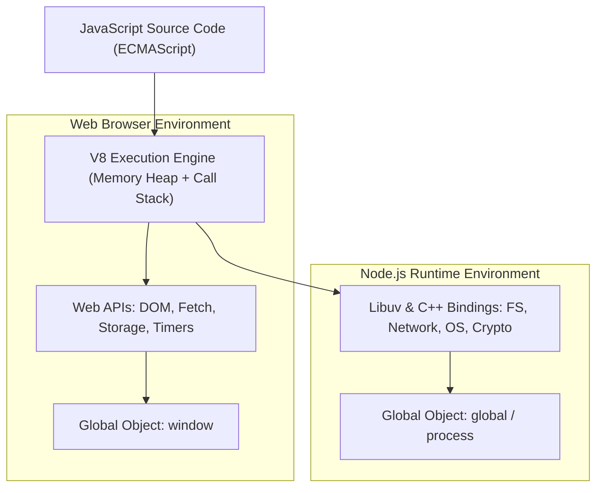

<div align="center">

# 🌐 JavaScript Core & Advanced Documentation

> *A comprehensive, color-coded reference manual and progression system spanning basic foundations, engine architecture, DOM manipulation, asynchronous programming, OOP, and production application design.*

[](00_README.md)
[](00_README.md)
[](https://developer.mozilla.org/en-US/docs/Web/JavaScript)
[](00_README.md)

---

</div>

## 🗺️ Progress Map

| Level | Color | Focus Area | Core Modules Covered | Source Mapping | File Link | Status |
| :---: | :---: | :--- | :--- | :---: | :--- | :---: |
| **01** | 🟩 | **Foundations & Syntax** | Data Types, Variables (`var`, `let`, `const`), Operators, Conditionals, Loops | Lec 29, 30 | [`01_foundations_and_syntax.md`](01_foundations_and_syntax.md) | 🟢 Complete |
| **02** | 🟦 | **Data Structures & Built-ins** | Functions, Math Object, Strings, Arrays, Higher-Order Methods, Objects | Lec 31, 32, 33, 34 | [`02_data_structures_and_builtins.md`](02_data_structures_and_builtins.md) | 🟢 Complete |
| **03** | 🟨 | **Engine Mechanics & Scoping** | Execution Context, Call Stack, Hoisting, TDZ, Scope Chain, Closures, `this`, Coercion | Lec 35, 36, 37, 38 | [`03_execution_context_scope_and_closures.md`](03_execution_context_scope_and_closures.md) | 🟢 Complete |
| **04** | 🟧 | **DOM & Browser Events** | DOM Tree Traversal, Selectors, Element Manipulation, Event Bubbling/Capturing, Forms | Lec 39, 40, 41 | [`04_dom_manipulation_and_events.md`](04_dom_manipulation_and_events.md) | 🟢 Complete |
| **05** | 🟥 | **Asynchronous JavaScript** | Event Loop, Call Stack, Microtasks, Timers, Callbacks, Promises, Async/Await | Lec 44, 45, 46, 47 | [`05_async_javascript_and_promises.md`](05_async_javascript_and_promises.md) | 🟢 Complete |
| **06** | 🟪 | **Web APIs, Storage & Networking** | LocalStorage, SessionStorage, BOM, XMLHttpRequest, Fetch API, Pitfalls & FAQs | Lec 48, 49 | [`06_web_apis_and_storage.md`](06_web_apis_and_storage.md) | 🟢 Complete |
| **07** | 🟦⬛ | **OOP, Prototypes & Classes** | Prototypes, `__proto__`, Constructor Functions, `new` keyword, ES6 Classes, `call`/`apply`/`bind` | Lec 52, 53, 54 | [`07_oop_prototypes_and_classes.md`](07_oop_prototypes_and_classes.md) | 🟢 Complete |
| **08** | ⬛ | **Application Architectures** | Todo App, Movie Search Engine with Routing, Full E-Commerce Store & Cart Architecture | Lec 42–43, 50–51, 55–57 | [`08_fullstack_projects_and_architecture.md`](08_fullstack_projects_and_architecture.md) | 🟢 Complete |

---

## ⚡ Quick-Reference Cheat Sheet

| Badge | Level | Primary Concepts | Key Terms, Methods & Syntaxes |
| :---: | :---: | :--- | :--- |
| 🟩 | **01** | Basic Syntax & Logic | `let`, `const`, `var`, `typeof`, `===`, `!==`, `&&`, `\|\|`, `!`, `? :`, `switch`, `for`, `while`, `do...while` |
| 🟦 | **02** | Core Built-in Objects | `function`, `=>`, `Math.random()`, `slice()`, `splice()`, `map()`, `filter()`, `reduce()`, `Object.keys()`, `for...in`, `for...of` |
| 🟨 | **03** | Runtime Internals | GEC, FEC, Call Stack, Hoisting, TDZ, Lexical Scope, Closure, `this`, `globalThis`, Implicit Coercion |
| 🟧 | **04** | Document Object Model | `querySelector()`, `innerHTML`, `textContent`, `classList`, `addEventListener()`, `e.target`, `closest()`, `preventDefault()` |
| 🟥 | **05** | Asynchronous Patterns | Event Loop, Task Queue, Microtask Queue, `setTimeout()`, `Promise`, `.then()`, `.catch()`, `async`, `await`, `Promise.all()` |
| 🟪 | **06** | Storage & Network | `localStorage`, `sessionStorage`, `JSON.stringify()`, `JSON.parse()`, `window`, `location`, `fetch()`, `Response.json()` |
| 🟦⬛ | **07** | Object Orientation | `prototype`, `__proto__`, `Object.create()`, `class`, `constructor`, `extends`, `super`, `call()`, `apply()`, `bind()` |
| ⬛ | **08** | Production Systems | State-driven UI, Event Delegation, URL query parameters (`URLSearchParams`), Cart state, Local persistence |

---

## ⚙️ Environmental Architecture & Key Setup Information

JavaScript runs primarily inside two hosting environments: the **Browser** and **Node.js**. Both share the core ECMAScript engine (e.g., Google V8 in Chrome & Node.js), but expose different host environments:



### Script Inclusion Best Practices

When integrating JavaScript within HTML documents:

```html
<!-- Recommended: Place script tag right before closing body tag -->
<body>
  <!-- All HTML Markup -->
  <div id="app"></div>

  <!-- Executed after DOM parsing completes -->
  <script src="index.js"></script>
</body>
```

Alternatively, when placed in the `<head>` tag:
```html
<!-- Defer script execution until HTML parsing has finished -->
<head>
  <script src="index.js" defer></script>
</head>
```

> [!NOTE]
> All examples in this documentation suite follow modern ECMAScript standards (ES6+), adopting strict equality (`===`), block scoping (`let` and `const`), and asynchronous patterns with `async`/`await`.
