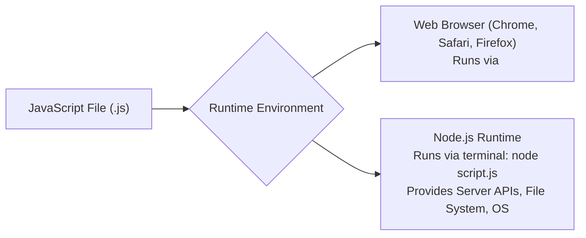
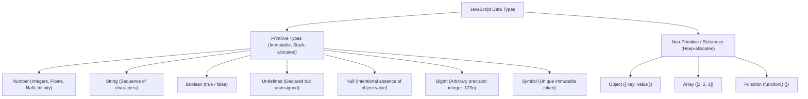

<div align="center">

# 🟩 <span style="color:#10B981">Level 01: Foundations & Syntax</span>

> *The absolute fundamentals of the JavaScript language: execution environments, memory allocation, variable scoping, data types, operators, and control flow structures.*

[](01_foundations_and_syntax.md)
[](01_foundations_and_syntax.md)
[](01_foundations_and_syntax.md)

---

</div>

## 📌 Table of Contents
- [1. Language Architecture & Runtime](#1-language-architecture--runtime)
- [2. Variables & Scoping Declarations](#2-variables--scoping-declarations)
- [3. Data Types & Representation](#3-data-types--representation)
- [4. Operators & Evaluation Mechanics](#4-operators--evaluation-mechanics)
- [5. Conditional Logic & Truthy/Falsy](#5-conditional-logic--truthyfalsy)
- [6. Iteration & Loop Structures](#6-iteration--loop-structures)
- [🎯 Practice Problems](#-practice-problems)
- [🧭 Summary Table](#-summary-table)

---

## 1. Language Architecture & Runtime

Computers execute low-level machine code (binary: `0`s and `1`s). High-level languages like JavaScript allow developers to write human-friendly code that is transformed for machine execution.

### Compiled vs. Interpreted Languages

| Parameter | Compiled Languages (C++, Java, Rust) | Interpreted Languages (Classic JS, Python) | Modern JavaScript Engine (V8) |
| :--- | :--- | :--- | :--- |
| **Translation** | Entire source converted to binary before execution | Translated line-by-line during runtime | JIT (Just-In-Time) Compilation: interpreter parses first, compiler optimizes hot code |
| **Execution Speed**| Fast runtime execution | Slower line-by-line overhead | Near-native speed due to adaptive compilation |
| **Feedback Loop** | Slow compilation phase, immediate type errors | Instant start, errors discovered during execution | Fast startup with ongoing profiling |

### Where JavaScript Runs



> [!NOTE]
> JavaScript is case-sensitive: `myVariable` and `myvariable` are treated as two distinct identifiers in memory.

---

## 2. Variables & Scoping Declarations

A **variable** acts as a named memory container ("box") allocated to store data values for later retrieval and manipulation.

### Declaration Keywords: `var` vs `let` vs `const`

| Feature | `var` (Legacy ES5) | `let` (Modern ES6) | `const` (Modern ES6) |
| :--- | :--- | :--- | :--- |
| **Scope** | Function scoped | Block scoped `{ }` | Block scoped `{ }` |
| **Re-declaration** | Allowed in same scope | ❌ SyntaxError | ❌ SyntaxError |
| **Re-assignment** | Allowed | Allowed | ❌ TypeError |
| **Initialization** | Optional (defaults to `undefined`) | Optional (defaults to `undefined`) | **Required** at time of declaration |
| **Hoisting** | Hoisted with `undefined` value | Hoisted in Temporal Dead Zone (TDZ) | Hoisted in Temporal Dead Zone (TDZ) |

```javascript
// var allows re-declaration (dangerous)
var age = 20;
var age = 25; // Valid with var

// let allows re-assignment but prevents duplicate declaration
let score = 100;
score = 150; // Valid
// let score = 200; // SyntaxError: Identifier 'score' has already been declared

// const locks variable reference
const PI = 3.14159;
// PI = 3.14; // TypeError: Assignment to constant variable.
// const MAX; // SyntaxError: Missing initializer in const declaration
```

> [!WARNING]
> Always prefer `const` by default. Only switch to `let` if you know the variable value needs to change (e.g., loop counters, accumulators). Avoid `var` entirely in modern applications to eliminate leakage and unpredictable hoisting bugs.

### Identifier Naming Conventions

```javascript
// Valid variable names:
let firstName = "Nishant"; // Must start with letter, _, or $
let _cacheId = 90210;
let $totalAmount = 5000;

// Invalid variable names:
// let 1stRank = "Winner"; // SyntaxError: Cannot start with a number
// let return = true;      // SyntaxError: Reserved keyword cannot be identifier
```

| Naming Style | Convention Format | Typical Usage in JavaScript |
| :--- | :--- | :--- |
| **camelCase** | `firstName`, `aadharCardNumber` | Standard variables, functions, methods |
| **snake_case** | `first_name`, `user_id` | Database columns, Python integration |
| **PascalCase** | `UserProfile`, `EcommerceCart` | ES6 Classes, React components, Constructors |
| **SCREAMING_SNAKE** | `DB_HOST`, `MAX_RETRIES` | Environment variables, immutable global constants |

---

## 3. Data Types & Representation

JavaScript is a **dynamically typed** language: data types are bound to values, not directly to variable containers. Types are grouped into two categories:



### Type Introspection with `typeof`

```javascript
typeof 42;             // "number"
typeof 3.14;           // "number"
typeof "Nishant";      // "string"
typeof true;           // "boolean"
typeof undefined;      // "undefined"
typeof 9007199254740991n; // "bigint"
typeof Symbol("id");   // "symbol"
typeof { a: 1 };       // "object"
typeof [1, 2, 3];      // "object"
typeof function(){};   // "function"
```

> [!CAUTION]
> **Historic Language Gotcha**: `typeof null` evaluates to `"object"`. This was an architectural flaw in the original 1995 JavaScript implementation (type tag 0 for objects matched null pointer `0x00`) and cannot be fixed without breaking web backward compatibility. To check for null specifically: `variable === null`.

### Template Literals vs Strings

```javascript
const user = "Nishant";
const items = 3;
const total = 1500;

// Traditional concatenation
console.log("Customer " + user + " purchased " + items + " items for Rs " + total);

// Modern ES6 Template Literal (using backticks `` and ${} interpolation)
console.log(`Customer ${user} purchased ${items} items for Rs ${total}`);
```

---

## 4. Operators & Evaluation Mechanics

### Arithmetic & Assignment Operators

```javascript
let a = 10;
let b = 3;

console.log(a + b);  // 13 (Addition)
console.log(a - b);  // 7  (Subtraction)
console.log(a * b);  // 30 (Multiplication)
console.log(a / b);  // 3.333... (Division/Quotient)
console.log(a % b);  // 1  (Modulus/Remainder)
console.log(a ** b); // 1000 (Exponentiation: 10^3)

// Compound Assignment
a += 5;  // a = a + 5 -> 15
a -= 2;  // a = a - 2 -> 13
a *= 2;  // a = a * 2 -> 26
a %= 4;  // a = a % 4 -> 2
```

### Pre-Increment vs Post-Increment

| Operator | Syntax | Evaluation Step | Return Value |
| :--- | :--- | :--- | :--- |
| **Post-Increment** | `num++` | Returns current value first, *then* increments variable | Original value |
| **Pre-Increment** | `++num` | Increments variable first, *then* returns new value | Incremented value |
| **Post-Decrement** | `num--` | Returns current value first, *then* decrements variable | Original value |
| **Pre-Decrement** | `--num` | Decrements variable first, *then* returns new value | Decremented value |

```javascript
let x = 5;
let y = x++; // y gets 5, then x becomes 6
console.log(x, y); // 6, 5

let p = 5;
let q = ++p; // p becomes 6, then q gets 6
console.log(p, q); // 6, 6
```

### Comparison Operators: Loose (`==`) vs Strict (`===`)

| Operator | Comparison Type | Type Coercion? | Example | Result |
| :--- | :--- | :---: | :--- | :---: |
| `==` | Loose Equality | Yes (converts types implicitly) | `5 == "5"` | `true` |
| `===` | Strict Equality | **No** (compares both value & type) | `5 === "5"` | `false` |
| `!=` | Loose Inequality | Yes | `5 != "5"` | `false` |
| `!==` | Strict Inequality | **No** | `5 !== "5"` | `true` |

> [!TIP]
> Always use strict equality (`===`) and strict inequality (`!==`) in production code to prevent unexpected type coercion bugs.

### Logical Operators & Short-Circuit Evaluation

```javascript
// AND (&&): Returns first falsy operand, or the last operand if all are truthy
console.log(true && "Hello");       // "Hello"
console.log(0 && "Skipped");        // 0 (short-circuits immediately)

// OR (||): Returns first truthy operand, or the last operand if all are falsy
console.log("Logged In" || "Guest");// "Logged In" (short-circuits immediately)
console.log("" || "Default Name");  // "Default Name"

// NOT (!): Inverts boolean truthiness
console.log(!true);                 // false
console.log(!"");                   // true
console.log(!!"Nishant");           // true (Double-bang casts any value to strict boolean)
```

---

## 5. Conditional Logic & Truthy/Falsy

### Truthy vs Falsy Table

Every value in JavaScript coerces to either `true` or `false` when evaluated inside a boolean context (like an `if` condition):

| Inherently Falsy Values (Only 8) | Inherently Truthy Values (Everything Else!) |
| :--- | :--- |
| `false` | `true` |
| `0` and `-0` | Any non-zero number (`1`, `-5`, `3.14`) |
| `0n` (BigInt zero) | `"0"`, `"false"` (non-empty strings!) |
| `""` (Empty string) | `" "` (string containing whitespace) |
| `null` | All objects `{}` and arrays `[]` (even empty ones!) |
| `undefined` | All functions `function() {}` |
| `NaN` (Not a Number) | Symbols, Dates, RegExp |

### Conditional Branching (`if`, `switch`, Ternary)

```javascript
// 1. If - Else If - Else Ladder
const marks = 82;

if (marks >= 90) {
  console.log("Grade: A+");
} else if (marks >= 80) {
  console.log("Grade: A");
} else if (marks >= 60) {
  console.log("Grade: B");
} else {
  console.log("Grade: Need Improvement");
}

// 2. Switch Case
const role = "admin";

switch (role) {
  case "admin":
    console.log("Full system access granted.");
    break; // Break prevents fallthrough to subsequent cases
  case "editor":
    console.log("Edit and publish access granted.");
    break;
  case "viewer":
    console.log("Read-only access.");
    break;
  default:
    console.log("Unrecognized role.");
}

// 3. Ternary Operator (condition ? exprIfTrue : exprIfFalse)
const age = 19;
const canVote = age >= 18 ? "Eligible to vote" : "Ineligible";
```

---

## 6. Iteration & Loop Structures

Loops allow execution of a block of code repeatedly until a condition evaluates to `false`.

### Comparison of Loop Types

| Loop Type | Check Timing | Minimum Runs | Best Used When... |
| :--- | :--- | :---: | :--- |
| `for` | Entry-controlled (before run) | `0` | Number of iterations is known in advance |
| `while` | Entry-controlled (before run) | `0` | Iterating until a condition changes dynamically |
| `do...while` | Exit-controlled (after run) | **`1`** | Body must execute at least once (e.g., prompt dialog) |

### Loop Syntax & Dry Run

```javascript
// 1. for loop
for (let i = 1; i <= 3; i++) {
  console.log(`Iteration: ${i}`);
}

// Dry run breakdown:
// i = 1 -> condition (1 <= 3) true -> execute body -> update i (i becomes 2)
// i = 2 -> condition (2 <= 3) true -> execute body -> update i (i becomes 3)
// i = 3 -> condition (3 <= 3) true -> execute body -> update i (i becomes 4)
// i = 4 -> condition (4 <= 3) false -> exit loop

// 2. while loop
let count = 3;
while (count > 0) {
  console.log(`Countdown: ${count}`);
  count--;
}

// 3. do-while loop (guaranteed at least one execution)
let attempts = 0;
do {
  console.log("Connecting to server...");
  attempts++;
} while (attempts < 1);
```

### Loop Control: `break` vs `continue`

```javascript
for (let i = 1; i <= 5; i++) {
  if (i === 2) {
    continue; // Skips printing 2 and jumps to i = 3
  }
  if (i === 4) {
    break;    // Terminates entire loop immediately
  }
  console.log(i); // Outputs: 1, then 3
}
```

---

## 🎯 Practice Problems

1. **Post vs Pre Increment Trace**:
   What is the value of `result` and `n` after executing `let n = 10; let result = n++ + ++n;`?
   > *Hint: Trace the value returned by `n++` first (value before increment), then determine what `++n` receives as its input value.*

2. **Truthy Short-Circuiting**:
   What does `console.log("" || 0 || "Default User" || "Admin");` print?
   > *Hint: Recall that `||` evaluates left-to-right and halts at the very first truthy value it encounters.*

---

## 🧭 Summary Table

| Concept | Purpose | Syntax Pattern |
| :--- | :--- | :--- |
| **`let` / `const`** | Modern block-scoped variable declaration | `const x = 10; let y = 20;` |
| **Strict Equality** | Comparison without type coercion | `val1 === val2` |
| **Template Literals** | Dynamic string interpolation | `` `Hello, ${name}` `` |
| **Logical Short-circuit** | Setting default fallbacks or guards | `const port = process.env.PORT \|\| 3000;` |
| **Ternary Operator** | Concise inline if/else statement | `cond ? ifTrue : ifFalse` |
| **`for` Loop** | Deterministic counter-driven repetition | `for (let i = 0; i < n; i++)` |
| **`break` / `continue`** | Control flow intervention in loops | `if (done) break; else continue;` |

---

<div align="center">

🏠 [Roadmap](00_README.md) | ➡️ [Level 02: Data Structures & Built-ins](02_data_structures_and_builtins.md)

</div>
