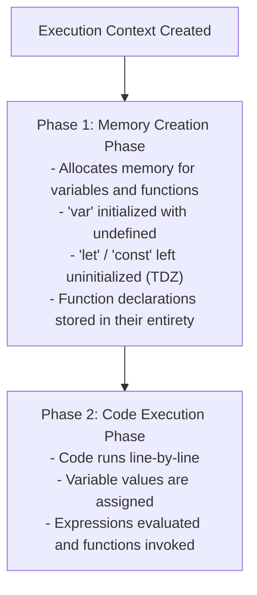
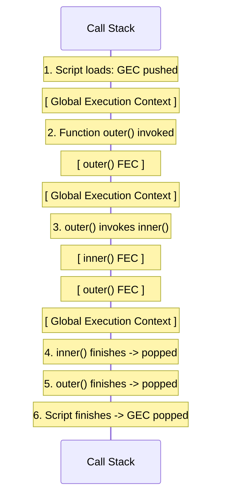
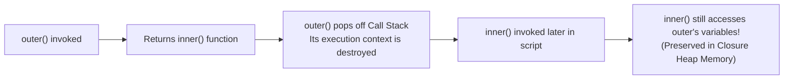

<div align="center">

# 🟨 <span style="color:#F59E0B">Level 03: Engine Mechanics, Scope & Closures</span>

> *The internal mechanics of JavaScript engines: Execution Contexts, Call Stack lifecycles, Hoisting and the Temporal Dead Zone, Scope Chains, Closures, dynamic `this` resolution, and Type Coercion.*

[](03_execution_context_scope_and_closures.md)
[](03_execution_context_scope_and_closures.md)
[](03_execution_context_scope_and_closures.md)

---

</div>

## 📌 Table of Contents
- [1. Execution Context & Call Stack Lifecycle](#1-execution-context--call-stack-lifecycle)
- [2. Hoisting & The Temporal Dead Zone (TDZ)](#2-hoisting--the-temporal-dead-zone-tdz)
- [3. Scope Types & The Lexical Scope Chain](#3-scope-types--the-lexical-scope-chain)
- [4. Closures & State Encapsulation](#4-closures--state-encapsulation)
- [5. The `this` Keyword Mechanics](#5-the-this-keyword-mechanics)
- [6. Type Coercion & Comparison Rules](#6-type-coercion--comparison-rules)
- [🎯 Practice Problems](#-practice-problems)
- [🧭 Summary Table](#-summary-table)

---

## 1. Execution Context & Call Stack Lifecycle

Everything in JavaScript executes inside an **Execution Context (EC)**. It acts as an environment container holding variable declarations, functions, and execution scope.

### The Two Primary Types of Execution Context

1. **Global Execution Context (GEC)**: Created automatically when a JavaScript script starts. Only one GEC exists per program.
2. **Function Execution Context (FEC)**: Created anew whenever a function is invoked.

### The Two Phases of Execution

Whenever an Execution Context is instantiated, the JavaScript engine processes code in two distinct sequential phases:



### The Call Stack

The **Call Stack** is a LIFO (Last In, First Out) stack data structure managing execution context transitions:



---

## 2. Hoisting & The Temporal Dead Zone (TDZ)

**Hoisting** is the JavaScript engine's behavior of allocating memory for variable and function declarations during Phase 1 (Memory Creation Phase) before executing any code.

### Hoisting Matrix: Variables vs Functions

| Entity Type | Hoisted in Phase 1? | Initial Value in Phase 1 | Accessing Before Declaration |
| :--- | :---: | :--- | :--- |
| **`var`** | Yes | `undefined` | Returns `undefined` (No error, but bug-prone) |
| **`let` / `const`** | Yes | *Uninitialized* (trapped in TDZ) | Throws `ReferenceError` |
| **Function Declaration** | Yes | Entire function definition | Runs successfully! |
| **Function Expression** | Variable hoisted | `undefined` (if `var`) or TDZ (if `let`/`const`) | Throws `TypeError` or `ReferenceError` |

### Code Comparison

```javascript
// 1. var Hoisting:
console.log(a); // undefined
var a = 10;
console.log(a); // 10

// 2. let / const Hoisting & Temporal Dead Zone (TDZ):
// console.log(b); // ReferenceError: Cannot access 'b' before initialization
// <--- TDZ for variable 'b' ends here --->
let b = 20;

// 3. Function Declaration Hoisting:
greet(); // "Hello from hoisted function!" (Works perfectly!)
function greet() {
  console.log("Hello from hoisted function!");
}

// 4. Function Expression Hoisting:
// sayHi(); // TypeError: sayHi is not a function (sayHi is currently undefined)
var sayHi = function() {
  console.log("Hi!");
};
```

> [!WARNING]
> The **Temporal Dead Zone (TDZ)** is the time span between entering scope and the actual line of declaration where `let` or `const` variables cannot be accessed. Always declare variables at the top of their scope to avoid TDZ errors.

---

## 3. Scope Types & The Lexical Scope Chain

**Scope** defines the accessibility boundary of variables and functions in code.

### Three Levels of Scope

1. **Global Scope**: Accessible everywhere across all scripts and functions.
2. **Function (Local) Scope**: Variables declared with `var`, `let`, or `const` inside a function body are private to that function.
3. **Block Scope**: `{ ... }` curly braces (e.g., inside `if`, `for`, `while`). Applies strictly to `let` and `const`.

```javascript
var globalVar = "I am global";

function testScope() {
  var functionScoped = "Inside function";
  
  if (true) {
    let blockScoped = "Inside block";
    var leakedVar = "Leaked from block"; // var ignores block scope!
  }

  // console.log(blockScoped); // ReferenceError: blockScoped is not defined
  console.log(leakedVar);      // "Leaked from block" (var escaped block!)
}

testScope();
// console.log(functionScoped); // ReferenceError: functionScoped is not defined
```

### The Lexical Scope Chain

JavaScript utilizes **Lexical Scoping** (static scoping): where a function is physically written in source code determines its scope access, regardless of where or how it is invoked.

When an identifier is referenced, the engine searches:
1. Current Local Scope
2. Enclosing Parent Function Scope
3. Step-by-step up outer lexical scopes...
4. Global Scope
5. If not found in Global Scope: `ReferenceError: identifier is not defined`.

```javascript
const globalNumber = 100;

function outer() {
  const outerNumber = 50;
  
  function inner() {
    const innerNumber = 10;
    // Engine resolves innerNumber locally (10),
    // outerNumber in parent outer() (50),
    // and globalNumber in Global Scope (100)
    console.log(innerNumber + outerNumber + globalNumber); // 160
  }
  
  inner();
}

outer();
```

---

## 4. Closures & State Encapsulation

A **closure** is a function bundled together with references to its surrounding state (its lexical environment).

> In JavaScript, an inner function **always retains access to the variables of its outer parent function**, even after the outer function has completed execution and has been popped off the Call Stack!



### Practical Closure: Private Counter & Encapsulation

```javascript
function createCounter(initialValue = 0) {
  let count = initialValue; // Private variable (encapsulated)

  return {
    increment: function() {
      count++;
      return count;
    },
    decrement: function() {
      count--;
      return count;
    },
    getCount: function() {
      return count;
    }
  };
}

const counterA = createCounter(10);
console.log(counterA.increment()); // 11
console.log(counterA.increment()); // 12
console.log(counterA.getCount());  // 12

// Note: count cannot be accessed or manipulated directly from outside!
// console.log(counterA.count); // undefined
```

### Practical Closure: Function Factory

```javascript
function createDiscountCalculator(discountPercent) {
  // discountPercent is retained in closure
  return function(price) {
    return price - (price * discountPercent / 100);
  };
}

const festivalOffer = createDiscountCalculator(20); // 20% discount
const vipOffer = createDiscountCalculator(40);      // 40% discount

console.log(festivalOffer(1000)); // 800
console.log(vipOffer(1000));      // 600
```

> [!TIP]
> **Memory & Closures**: Closures maintain references to outer variables in memory heap. Keep closures focused on variables they actually need to avoid retaining unnecessary data.

---

## 5. The `this` Keyword Mechanics

The `this` keyword refers to the **object that is currently executing the surrounding function**. Its value is determined dynamically at call-time (except for arrow functions).

### `this` Value Matrix Across Contexts

| Invocation Context | Non-Strict Mode | Strict Mode (`"use strict"`) |
| :--- | :--- | :--- |
| **Global Scope** | `window` (Browser) or `global` (Node) | `window` / `global` |
| **Simple Function Call** | `window` (Browser) | `undefined` |
| **Object Method Call** | The object before the dot (`obj.method()`) | The object before the dot |
| **Nested Regular Function** | Reverts to `window` | Reverts to `undefined` |
| **Arrow Function** | Lexically inherited from enclosing scope | Lexically inherited from enclosing scope |

### Method vs Nested Regular Function vs Arrow Function

```javascript
const user = {
  name: "Nishant",
  
  // Standard method: 'this' refers to user
  greetRegular: function() {
    console.log(`Regular: Hello, I am ${this.name}`);
    
    // Gotcha: Nested standard function loses 'this' binding
    function nestedNormal() {
      console.log(`Nested Normal: ${this?.name}`); // undefined (in strict mode, this is undefined)
    }
    nestedNormal();

    // Solution: Arrow function inherits 'this' from greetRegular()
    const nestedArrow = () => {
      console.log(`Nested Arrow: Hello, I am ${this.name}`); // "Nishant"
    };
    nestedArrow();
  },

  // Gotcha: Arrow function directly on object does NOT get object as 'this'!
  greetArrowMethod: () => {
    console.log(`Arrow Method: ${this?.name}`); // undefined (inherits from Global window)
  }
};

user.greetRegular();
user.greetArrowMethod();
```

> [!CAUTION]
> Never use arrow functions as top-level methods on object literals if they need to access the object via `this`. Arrow functions do not define their own `this`; they look upwards to global scope.

---

## 6. Type Coercion & Comparison Rules

**Coercion** is the automatic (implicit) or manual (explicit) conversion of a value from one data type to another.

### Explicit Coercion (Manual)

```javascript
Number("123");       // 123
String(456);         // "456"
Boolean(1);          // true
Boolean(0);          // false
```

### Implicit Coercion (Automatic Engine Conversion)

#### 1. The Addition (`+`) Operator
If **any** operand is a string, JavaScript converts the remaining operands to strings and performs string concatenation:

```javascript
console.log("5" + 2);        // "52"  (string)
console.log(10 + 20 + "30"); // "3030" (10+20=30, then 30 + "30" = "3030")
console.log("30" + 10 + 20); // "301020" ("30"+10="3010", "3010"+20="301020")
```

#### 2. Subtraction (`-`), Multiplication (`*`), Division (`/`), Modulus (`%`)
These operators coerce operands to **numbers**:

```javascript
console.log("10" - 2);   // 8  (numeric subtraction)
console.log("5" * "4");  // 20 (numeric multiplication)
console.log("10" / "2"); // 5
console.log("50" - "abc");// NaN (abc cannot convert to a number)
```

#### 3. Loose Equality (`==`) Coercion Traps

```javascript
console.log(0 == false);        // true  (false coerced to 0)
console.log("" == false);       // true  ("" coerced to 0, false to 0)
console.log(null == undefined); // true  (special ECMA rule: null and undefined loosely equal each other)
console.log(null === undefined);// false (strict comparison: different types)
```

---

## 🎯 Practice Problems

1. **Tricky Closure Counter**:
   Examine the following code:
   ```javascript
   function buildFunctions() {
     const arr = [];
     for (var i = 0; i < 3; i++) {
       arr.push(function() { return i; });
     }
     return arr;
   }
   const fns = buildFunctions();
   console.log(fns[0](), fns[1](), fns[2]());
   ```
   What does this output, and how does changing `var i` to `let i` fix it?
   > *Hint: `var` is function-scoped; all three functions share the exact same reference to `i` after the loop finishes. `let` creates a distinct block scope per loop iteration.*

2. **Lexical `this` in Nested Callbacks**:
   In a timer inside an object method:
   ```javascript
   const timer = {
     seconds: 0,
     start: function() {
       setTimeout(function() {
         this.seconds++;
         console.log(this.seconds);
       }, 1000);
     }
   };
   timer.start();
   ```
   Why does `this.seconds` log `NaN` or fail, and how do you fix it using an arrow function?
   > *Hint: When `setTimeout` invokes a normal function, it invokes it as a standalone function call with global `this`.*

---

## 🧭 Summary Table

| Concept | Purpose | Rule / Mechanism |
| :--- | :--- | :--- |
| **Execution Context** | Environment where JS code executes | Two phases: Memory Creation then Code Execution |
| **Call Stack** | Coordinates execution context order | LIFO: pushes on call, pops on return |
| **Hoisting** | Memory pre-allocation in Phase 1 | `var` -> `undefined`, `let`/`const` -> TDZ, functions -> hoisted whole |
| **Scope Chain** | Identifier lookup mechanism | Walks up lexical parent scopes until global scope |
| **Closure** | Function retaining parent scope | Enclosed function remembers outer variables after parent return |
| **`this` Keyword** | Current execution context reference | Dynamic based on caller; lexical in arrow functions |
| **Implicit Coercion** | Automatic engine type conversion | `+` prefers strings, `-`, `*`, `/` prefer numbers |

---

<div align="center">

⬅️ [Level 02: Data Structures & Built-ins](02_data_structures_and_builtins.md) | 🏠 [Roadmap](00_README.md) | ➡️ [Level 04: DOM & Browser Events](04_dom_manipulation_and_events.md)

</div>
