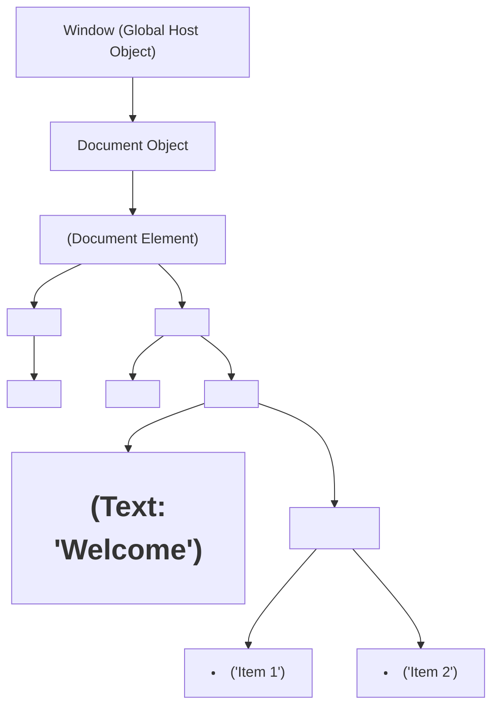
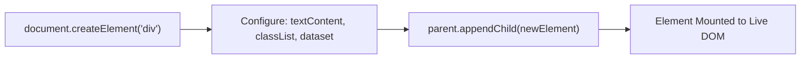
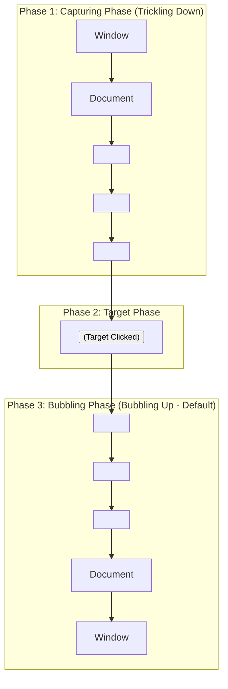

<div align="center">

# 🟧 <span style="color:#EA580C">Level 04: DOM Manipulation & Browser Events</span>

> *Interactive web engineering: Document Object Model traversal, element creation and mutation, style manipulation, event lifecycle bubbling/capturing, delegation architectures, and form validation.*

[](04_dom_manipulation_and_events.md)
[](04_dom_manipulation_and_events.md)
[](04_dom_manipulation_and_events.md)

---

</div>

## 📌 Table of Contents
- [1. DOM Architecture & The Node Hierarchy](#1-dom-architecture--the-node-hierarchy)
- [2. Element Selectors Compared](#2-element-selectors-compared)
- [3. Reading & Modifying Content and Styles](#3-reading--modifying-content-and-styles)
- [4. Creating, Appending & Deleting Elements](#4-creating-appending--deleting-elements)
- [5. The Browser Event System & Event Object](#5-the-browser-event-system--event-object)
- [6. Event Propagation & Event Delegation](#6-event-propagation--event-delegation)
- [7. Form Handling & Client-Side Validation](#7-form-handling--client-side-validation)
- [🎯 Practice Problems](#-practice-problems)
- [🧭 Summary Table](#-summary-table)

---

## 1. DOM Architecture & The Node Hierarchy

The **Document Object Model (DOM)** is a tree-like object-oriented representation of an HTML document created by the browser during parsing. It exposes an API allowing JavaScript to inspect, manipulate, style, and delete web page elements dynamically.



---

## 2. Element Selectors Compared

JavaScript provides multiple methods to locate and select DOM nodes from the `document`:

| Selector Method | Parameter Format | Returns | Collection Type | Native `.forEach()`? |
| :--- | :--- | :--- | :--- | :---: |
| `getElementById()` | `"main-title"` | Single `Element` or `null` | N/A | N/A |
| `getElementsByClassName()`| `"card"` | All matching elements | Live `HTMLCollection` | ❌ |
| `getElementsByTagName()` | `"p"` | All matching elements | Live `HTMLCollection` | ❌ |
| `querySelector()` | CSS: `"#id"`, `".cls"`, `"div > p"`| **First** matching `Element` | N/A | N/A |
| `querySelectorAll()` | Any valid CSS selector | All matching elements | Static `NodeList` | **✅ Yes** |

```javascript
// 1. Single element lookup
const title = document.getElementById("main-heading");
const submitBtn = document.querySelector(".btn-submit");

// 2. Multi-element lookup: querySelectorAll returns a NodeList with .forEach
const productCards = document.querySelectorAll(".product-card");
productCards.forEach((card, index) => {
  console.log(`Card ${index + 1}:`, card);
});

// 3. Live HTMLCollection gotcha (getElementsByClassName):
const liveCards = document.getElementsByClassName("product-card");
// liveCards.forEach(...); // TypeError: liveCards.forEach is not a function
// Convert to regular array if array methods are needed:
Array.from(liveCards).forEach(card => console.log(card));
```

> [!TIP]
> Modern JavaScript code standardizes almost exclusively on `querySelector()` (for single elements) and `querySelectorAll()` (for lists) due to their flexible CSS selector syntax.

---

## 3. Reading & Modifying Content and Styles

### Text & Markup Properties Compared

| Property | Parses HTML Tags? | Renders Hidden Text? | Performance Impact |
| :--- | :---: | :---: | :--- |
| **`innerHTML`** | **Yes** (creates child elements) | Yes | High (Forces HTML parser rebuild & reflow) |
| **`innerText`** | No (escapes HTML tags) | **No** (aware of styling, ignores `display:none`) | Medium (Triggers layout recalculation) |
| **`textContent`**| No (escapes HTML tags) | **Yes** (returns raw text of all nodes) | **Lowest** (Fastest, does not trigger reflow) |

```javascript
const banner = document.querySelector("#banner");

// Modifying text securely
banner.textContent = "Flash Sale: 50% Off Everything!";

// Modifying HTML markup
banner.innerHTML = `<span class="badge">Sale</span> <strong>50% Off</strong>`;
```

> [!CAUTION]
> **Cross-Site Scripting (XSS) Hazard**: Never inject unsanitized user inputs directly into `innerHTML` (e.g., `element.innerHTML = userInput`). Malicious users can inject `` scripts. Use `textContent` for plain text inputs.

### Attribute Manipulation

```javascript
const link = document.querySelector("#promo-link");

// Reading attributes
console.log(link.getAttribute("href")); // "https://example.com"

// Updating or adding attributes
link.setAttribute("href", "https://newsite.com");
link.setAttribute("target", "_blank");

// Checking and removing
if (link.hasAttribute("disabled")) {
  link.removeAttribute("disabled");
}
```

### ClassList API vs Inline Styles

```javascript
const button = document.querySelector(".btn");

// Preferred: Class manipulation via classList
button.classList.add("active", "primary");
button.classList.remove("disabled");
button.classList.toggle("selected"); // Toggles on/off
console.log(button.classList.contains("active")); // true

// Direct inline styling (uses camelCase property names)
button.style.backgroundColor = "#10B981";
button.style.fontSize = "16px";
button.style.display = "flex";
```

---

## 4. Creating, Appending & Deleting Elements

Dynamic web applications generate elements programmatically from data arrays (e.g., rendering cards for products or videos).



### Complete Dynamic Rendering Workflow

```javascript
const products = [
  { id: 101, title: "Mechanical Keyboard", price: 3499, inStock: true },
  { id: 102, title: "Gaming Mouse", price: 1499, inStock: false }
];

const container = document.querySelector("#product-grid");

products.forEach(product => {
  // 1. Create wrapper element
  const card = document.createElement("div");
  card.classList.add("product-card");
  card.dataset.id = product.id; // Adds data-id="101"

  // 2. Construct inner markup
  const title = document.createElement("h3");
  title.textContent = product.title;

  const priceTag = document.createElement("p");
  priceTag.textContent = `Price: Rs ${product.price}`;

  const button = document.createElement("button");
  button.textContent = product.inStock ? "Add to Cart" : "Out of Stock";
  button.disabled = !product.inStock;
  button.classList.add("btn-cart");

  // 3. Assemble and attach to DOM parent
  card.append(title, priceTag, button);
  container.appendChild(card);
});

// Removing elements:
// card.remove(); // Removes element directly from DOM
```

---

## 5. The Browser Event System & Event Object

An **event** is a signal that something has occurred in the browser (user interaction or system notification).

### Event Listeners: `addEventListener`

```javascript
const btn = document.querySelector("#checkout-btn");

function handleCheckout(event) {
  console.log("Event Type:", event.type);          // "click"
  console.log("Target Element:", event.target);     // The clicked button
  console.log("Mouse Coordinates:", event.clientX, event.clientY);
}

// Attach listener
btn.addEventListener("click", handleCheckout);

// Clean up listener when no longer required
// btn.removeEventListener("click", handleCheckout);
```

### Event Object Properties: `target` vs `currentTarget`

| Property | Meaning | Behavior During Bubbling |
| :--- | :--- | :--- |
| **`event.target`** | The **origin** element that directly triggered the event | Remains the exact element clicked (e.g., `<button>` or `<i>`) |
| **`event.currentTarget`** | The element to which the **event listener is bound** | Always references the element holding the listener |

---

## 6. Event Propagation & Event Delegation

### The 3 Phases of Event Propagation



```javascript
// Controlling propagation
button.addEventListener("click", (e) => {
  e.stopPropagation(); // Stops event from bubbling up to parent ancestors
  console.log("Button clicked without triggering parent listeners.");
});
```

### Event Delegation Architecture

Instead of binding individual event listeners to hundreds of child elements, **Event Delegation** binds a single listener to their common ancestor container and evaluates `e.target`:

```javascript
const cartList = document.querySelector("#cart-items");

// Single listener handles delete clicks for infinite list items!
cartList.addEventListener("click", (e) => {
  // Check if clicked element (or its closest ancestor) is a delete button
  const deleteBtn = e.target.closest(".btn-delete");
  
  if (deleteBtn) {
    const itemRow = deleteBtn.closest(".cart-row");
    const itemId = itemRow.dataset.id;
    console.log(`Deleting item ${itemId} from cart`);
    itemRow.remove(); // Direct removal
  }
});
```

> [!TIP]
> `element.closest(selector)` traverses up the DOM tree from `e.target` to find the nearest matching ancestor. It guarantees clicks on nested icons (`<button><i class="trash"></i> Delete</button>`) correctly resolve to the button.

---

## 7. Form Handling & Client-Side Validation

### Submissions & `preventDefault()`

Browsers default to reloading the page or submitting via standard HTTP requests when a form is submitted. In modern JavaScript applications, `e.preventDefault()` halts this behavior:

```javascript
const signupForm = document.querySelector("#signup-form");
const emailInput = document.querySelector("#email-field");
const passwordInput = document.querySelector("#password-field");
const errorMessage = document.querySelector("#error-msg");

signupForm.addEventListener("submit", (e) => {
  e.preventDefault(); // Halt standard browser page reload!

  const email = emailInput.value.trim();
  const password = passwordInput.value.trim();

  // Basic validation rules
  if (!email || !password) {
    showError("All fields are strictly required.");
    return;
  }

  const emailPattern = /^[^\s@]+@[^\s@]+\.[^\s@]+$/;
  if (!emailPattern.test(email)) {
    showError("Please enter a valid email address.");
    return;
  }

  if (password.length < 8) {
    showError("Password must contain at least 8 characters.");
    return;
  }

  // Clear errors and submit data
  errorMessage.textContent = "";
  console.log("Form validated successfully:", { email, password });
});

function showError(msg) {
  errorMessage.textContent = msg;
  errorMessage.style.color = "#DC2626";
}
```

### Input Event Types: `input` vs `change` vs `blur`

| Event Type | Trigger Timing | Primary Use Case |
| :--- | :--- | :--- |
| **`input`** | Fires **immediately on every keystroke** | Live character counters, instant search filter |
| **`change`** | Fires when element value changes and **loses focus** | Dropdown select menus, checkboxes |
| **`blur`** | Fires as soon as input loses focus | Field-by-field validation warnings |

```javascript
const commentBox = document.querySelector("#comment");
const charCounter = document.querySelector("#char-count");
const MAX_CHARS = 100;

// Live character counter using 'input' event
commentBox.addEventListener("input", (e) => {
  const currentLength = e.target.value.length;
  const remaining = MAX_CHARS - currentLength;
  charCounter.textContent = `${remaining} characters remaining`;
  
  if (remaining < 0) {
    charCounter.style.color = "#DC2626";
  } else {
    charCounter.style.color = "inherit";
  }
});
```

---

## 🎯 Practice Problems

1. **Event Delegation on Dynamic Todo List**:
   You have a `<ul>` containing multiple `<li>` items, each with a checkbox `<input type="checkbox" class="toggle">` and a delete button `<button class="delete">X</button>`. Write a single event listener on the `<ul>` that toggles a `.completed` class on the `<li>` when the checkbox changes, and removes the `<li>` when the delete button is clicked.
   > *Hint: Use `e.target.matches()` or `e.target.closest()` to identify whether the target was the checkbox or the delete button.*

2. **Live Input Filter**:
   Given an `<input type="text" id="search">` and a list of items `document.querySelectorAll(".item")`, implement live filtering where items whose `textContent` does not include the search query get `style.display = "none"`.
   > *Hint: Listen to the `"input"` event and use `toLowerCase().includes()` for case-insensitive matching.*

---

## 🧭 Summary Table

| Concept | Purpose | Code Snippet |
| :--- | :--- | :--- |
| **`querySelector`** | Select element using CSS syntax | `document.querySelector(".card")` |
| **`textContent`** | Read or update text without HTML parsing | `el.textContent = "Safe Text"` |
| **`createElement`** | Construct new DOM node in memory | `const div = document.createElement("div")` |
| **`appendChild` / `append`** | Mount element into active DOM hierarchy | `parent.append(child1, child2)` |
| **`addEventListener`** | Register event reaction callback | `btn.addEventListener("click", fn)` |
| **`e.preventDefault()`** | Halt default browser behavior | `e.preventDefault()` (e.g. form reload) |
| **Event Delegation** | Handle events on dynamic children via parent | `parent.addEventListener("click", e => ...)` |
| **`closest()`** | Match closest ancestor element | `e.target.closest(".item-card")` |

---

<div align="center">

⬅️ [Level 03: Engine Mechanics & Scoping](03_execution_context_scope_and_closures.md) | 🏠 [Roadmap](00_README.md) | ➡️ [Level 05: Asynchronous JavaScript & Promises](05_async_javascript_and_promises.md)

</div>
