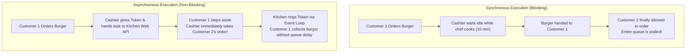
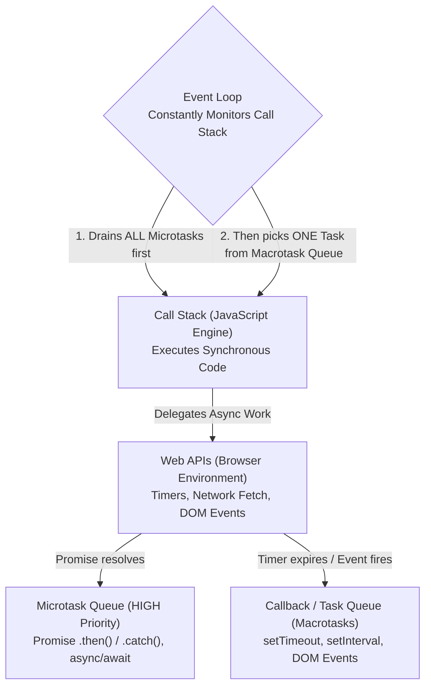
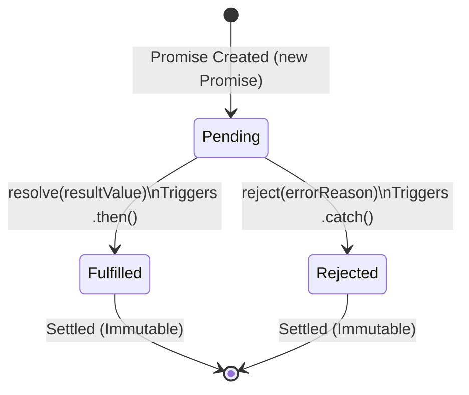

<div align="center">

# 🟥 <span style="color:#DC2626">Level 05: Asynchronous JavaScript & Promises</span>

> *Non-blocking concurrency architecture: Event Loop mechanics, Call Stack coordination, Callback Hell resolution, ES6 Promises, async/await synchronization, and Promise combinator methods.*

[](05_async_javascript_and_promises.md)
[](05_async_javascript_and_promises.md)
[](05_async_javascript_and_promises.md)

---

</div>

## 📌 Table of Contents
- [1. Synchronous vs Asynchronous Concurrency](#1-synchronous-vs-asynchronous-concurrency)
- [2. The Event Loop Architecture](#2-the-event-loop-architecture)
- [3. Browser Timers: `setTimeout` & `setInterval`](#3-browser-timers-settimeout--setinterval)
- [4. Callbacks, Pyramid of Doom & Inversion of Control](#4-callbacks-pyramid-of-doom--inversion-of-control)
- [5. ES6 Promises: Architecture & Chaining](#5-es6-promises-architecture--chaining)
- [6. `async` / `await` Syntax & Error Handling](#6-async--await-syntax--error-handling)
- [7. Promise Combinator Methods](#7-promise-combinator-methods)
- [🎯 Practice Problems](#-practice-problems)
- [🧭 Summary Table](#-summary-table)

---

## 1. Synchronous vs Asynchronous Concurrency

JavaScript is a **single-threaded** programming language: it contains exactly **one Call Stack** and can execute only one instruction at any single moment.

### The Burger Shop Analogy



### The Danger of Main-Thread Blocking

If time-consuming operations (network fetches, heavy loops) run synchronously on the main thread, the browser freezes:

```javascript
// DANGEROUS: Blocking busy-wait loop freezes the entire browser tab!
function blockMainThread(durationMs) {
  const start = Date.now();
  while (Date.now() - start < durationMs) {
    // Call stack is trapped inside this loop; UI cannot render or respond to clicks!
  }
}

// blockMainThread(5000); // Freezes browser for 5 seconds
```

---

## 2. The Event Loop Architecture

To handle non-blocking asynchronous operations, the JavaScript runtime engine collaborates with the surrounding browser environment through the **Event Loop**:



### The Strict Event Loop Priority Rule

1. Execute all synchronous code currently in the **Call Stack** until it is completely empty.
2. Check the **Microtask Queue** (Promises). Drain **every single microtask** until the Microtask Queue is completely empty.
3. Check the **Callback / Task Queue** (Macrotasks). Take **one task**, push it to the Call Stack, and execute it.
4. Repeat the cycle continuously.

```javascript
console.log("1. Synchronous Start");

setTimeout(() => {
  console.log("4. Task Queue (setTimeout callback)");
}, 0);

Promise.resolve().then(() => {
  console.log("3. Microtask Queue (Promise resolution)");
});

console.log("2. Synchronous End");

// Output Order:
// 1. Synchronous Start
// 2. Synchronous End
// 3. Microtask Queue (Promise resolution)  <- Microtask preempts setTimeout!
// 4. Task Queue (setTimeout callback)
```

---

## 3. Browser Timers: `setTimeout` & `setInterval`

Timers are provided by browser Web APIs, not the core JavaScript engine itself.

| Timer Function | Purpose | Return Value | Cancellation Method |
| :--- | :--- | :--- | :--- |
| `setTimeout(fn, delay)` | Runs callback once after delay | Timer ID (integer) | `clearTimeout(timerId)` |
| `setInterval(fn, interval)` | Runs callback repeatedly every interval | Interval ID (integer) | `clearInterval(intervalId)` |

```javascript
// 1. One-time delayed execution
const timerId = setTimeout(() => {
  console.log("Executed after minimum 2 seconds");
}, 2000);

// Cancel if condition met
clearTimeout(timerId);

// 2. Periodic interval execution
let seconds = 0;
const intervalId = setInterval(() => {
  seconds++;
  console.log(`Elapsed time: ${seconds}s`);

  if (seconds >= 3) {
    clearInterval(intervalId); // Halt interval after 3 seconds
    console.log("Interval stopped.");
  }
}, 1000);
```

> [!WARNING]
> The `delay` in `setTimeout(fn, delay)` guarantees only the **minimum** waiting time before the callback is placed into the Task Queue. If the Call Stack is busy with heavy computations, the actual execution may be delayed further.

---

## 4. Callbacks, Pyramid of Doom & Inversion of Control

A **callback function** is a function passed as an argument to another function to be executed once an asynchronous operation completes.

### Sequential Workflows & The "Pyramid of Doom"

In real-world applications (like an e-commerce food order system), tasks must execute in strict sequence:

```javascript
// The Callback Hell (Pyramid of Doom)
searchPizza("Pepperoni", function(pizza) {
  addToCart(pizza, function(cart) {
    applyDiscount(cart, function(discountedCart) {
      addDeliveryAddress(function(address) {
        processPayment(discountedCart, function(receipt) {
          sendOrderNotification(receipt, function() {
            console.log("Order completely finalized!");
          });
        });
      });
    });
  });
});
```

### The Two Critical Flaws of Callbacks

1. **Unmaintainable Pyramid (Pyramid of Doom)**: Deeply nested indentation that makes reading, debugging, and handling errors extremely error-prone.
2. **Inversion of Control**: By passing your critical callback (e.g., `processPayment`) into a third-party function, you surrender control over execution. You trust that the third-party code won't:
   - Call your callback twice (charging the customer double).
   - Never call your callback (hanging the user UI).
   - Call your callback with incorrect arguments.

---

## 5. ES6 Promises: Architecture & Chaining

Introduced in ECMAScript 2015 (ES6), a **Promise** is a dedicated JavaScript object representing the eventual completion (or failure) of an asynchronous task and its resulting value.

### How Promises Solve Inversion of Control

A Promise gives control **back** to your code. Instead of passing callbacks into external functions, the external function returns a Promise object to you. Once settled, a Promise becomes **immutable**: it can resolve or reject exactly once and can never transition back to pending.

### The 3 States of a Promise



### Producing a Promise

```javascript
function orderPizza(pizzaName) {
  // Promise constructor takes an executor function (resolve, reject)
  return new Promise((resolve, reject) => {
    console.log(`Baking ${pizzaName}...`);
    const isAvailable = true;

    setTimeout(() => {
      if (isAvailable) {
        resolve({ item: pizzaName, price: 499, status: "Ready" }); // Success
      } else {
        reject(new Error(`${pizzaName} is currently out of stock.`)); // Failure
      }
    }, 1500);
  });
}
```

### Consuming Promises via Chaining

Each `.then()` returns a **new Promise**, allowing linear, readable chaining that flattens Callback Hell:

```javascript
orderPizza("Farmhouse Pizza")
  .then((pizza) => {
    console.log("Step 1: Pizza prepared:", pizza);
    return pizza.price; // Passes 499 to next .then
  })
  .then((price) => {
    console.log(`Step 2: Processing payment of Rs ${price}`);
    return "PAYMENT_SUCCESS_TXN_9912";
  })
  .then((txnId) => {
    console.log(`Step 3: Receipt confirmed with Txn ID: ${txnId}`);
  })
  .catch((error) => {
    // Catches ANY error occurring anywhere along the entire chain!
    console.error("Order Failed:", error.message);
  })
  .finally(() => {
    // Always runs regardless of fulfillment or rejection
    console.log("Order session finished.");
  });
```

---

## 6. `async` / `await` Syntax & Error Handling

Introduced in ES2017, `async` and `await` are syntactic sugar over Promises that enable asynchronous code to be written with the clean, readable appearance of synchronous code.

### Core Rules of `async` / `await`

- **`async` keyword**: Placed before a function declaration. An `async` function **always returns a Promise** (non-promise returns are automatically wrapped via `Promise.resolve()`).
- **`await` keyword**: Can only be used inside `async` functions. It pauses function execution until the target Promise settles, **without blocking the browser main thread**!

### Comparison: `.then()` vs `async` / `await`

| Feature | Promise Chaining (`.then()`) | `async` / `await` |
| :--- | :--- | :--- |
| **Syntax Style** | Functional chaining with nested callbacks | Synchronous-looking sequential flow |
| **Error Handling** | Dedicated `.catch()` method at chain bottom | Standard `try...catch...finally` blocks |
| **Intermediate Values** | Awkward parameter passing down the chain | Normal variable assignment |
| **Readability** | Good, but can grow verbose | High, clear mental model |

```javascript
// Clean async / await implementation with try-catch
async function executePizzaOrder() {
  try {
    console.log("Starting order process...");
    
    // Await pauses execution within this async function only!
    const pizza = await orderPizza("Paneer Special");
    console.log("Pizza received:", pizza);

    const paymentResult = await processPayment(pizza.price);
    console.log("Payment status:", paymentResult);

    const notification = await sendNotification();
    console.log("Notification status:", notification);
  } catch (error) {
    // Catches any rejection or runtime exception
    console.error("Failed during order execution:", error.message);
  } finally {
    console.log("Cleaned up resources and closed modal.");
  }
}

executePizzaOrder();
```

---

## 7. Promise Combinator Methods

When managing multiple asynchronous tasks concurrently, JavaScript provides 4 static combinator methods on `Promise`:

| Combinator | Wait Criterion | Resolves When... | Rejects When... |
| :--- | :--- | :--- | :--- |
| **`Promise.all()`** | All promises | **All** promises fulfill (returns array of results) | **Any** single promise rejects (short-circuits immediately) |
| **`Promise.allSettled()`** | All promises | **All** promises settle (returns `{ status, value/reason }`) | **Never rejects** |
| **`Promise.race()`** | First promise | **First** promise settles (whether fulfilled or rejected) | **First** promise settles (if it rejects first) |
| **`Promise.any()`** | First fulfilled | **First** promise fulfills | **All** promises reject (`AggregateError`) |

### Practical Code Examples

```javascript
const fetchUsers = new Promise(res => setTimeout(() => res(["Alice", "Bob"]), 1000));
const fetchPosts = new Promise(res => setTimeout(() => res(["Post 1", "Post 2"]), 1500));
const fetchErrors = new Promise((_, rej) => setTimeout(() => rej("Service Unavailable"), 800));

// 1. Promise.all: Concurrent dashboard data fetching (All or Nothing)
Promise.all([fetchUsers, fetchPosts])
  .then(([users, posts]) => {
    console.log("All data ready:", { users, posts });
  })
  .catch(err => console.error("One request failed:", err));

// 2. Promise.allSettled: Independent inspections without short-circuiting
Promise.allSettled([fetchUsers, fetchErrors])
  .then(results => {
    results.forEach(res => {
      if (res.status === "fulfilled") {
        console.log("Success value:", res.value);
      } else {
        console.log("Failed reason:", res.reason);
      }
    });
  });

// 3. Promise.race: Timeout benchmark
const timeout = new Promise((_, rej) => setTimeout(() => rej("Request Timed Out"), 1200));
Promise.race([fetchUsers, timeout])
  .then(data => console.log("Data arrived in time:", data))
  .catch(err => console.error(err));
```

---

## 🎯 Practice Problems

1. **Microtask Priority Prediction**:
   Trace the exact console logging sequence:
   ```javascript
   console.log("A");
   setTimeout(() => console.log("B"), 0);
   Promise.resolve().then(() => {
     console.log("C");
     return Promise.resolve("D");
   }).then(val => console.log(val));
   console.log("E");
   ```
   > *Hint: Identify all synchronous lines first, then drain the complete Microtask Queue before allowing any task from the Task Queue to enter.*

2. **Sequential vs Concurrent `await`**:
   Compare the execution duration of:
   ```javascript
   // Case 1
   const u = await fetchUsers();
   const p = await fetchPosts();

   // Case 2
   const [u2, p2] = await Promise.all([fetchUsers(), fetchPosts()]);
   ```
   Why is Case 2 twice as fast when each call takes 1 second?
   > *Hint: Case 1 runs in serial (waterfall), waiting for the first promise to finish before starting the second. Case 2 launches both promises concurrently.*

---

## 🧭 Summary Table

| Concept | Purpose | Code Pattern |
| :--- | :--- | :--- |
| **Event Loop** | Orchestrates async callbacks between queues & stack | Monitored continuously by runtime |
| **Microtask Queue** | High-priority queue reserved for Promises | Prompts processed before next Macrotask |
| **`setTimeout()`** | Execute callback after minimum time delay | `setTimeout(fn, 1000)` |
| **`new Promise`** | Wrap async task in an immutable object | `new Promise((res, rej) => ...)` |
| **Promise Chaining** | Flatten sequential async operations | `p.then(s1).then(s2).catch(err)` |
| **`async` / `await`** | Synchronous-looking promise synchronization | `const data = await fetch(url)` |
| **`Promise.all`** | Run multiple concurrent tasks (All-or-Nothing) | `Promise.all([p1, p2])` |
| **`Promise.allSettled`** | Run tasks without failing on individual rejections | `Promise.allSettled([p1, p2])` |

---

<div align="center">

⬅️ [Level 04: DOM & Browser Events](04_dom_manipulation_and_events.md) | 🏠 [Roadmap](00_README.md) | ➡️ [Level 06: Web APIs, Storage & Networking](06_web_apis_and_storage.md)

</div>
