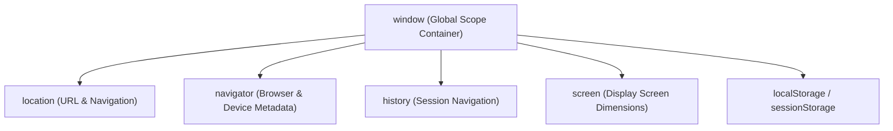
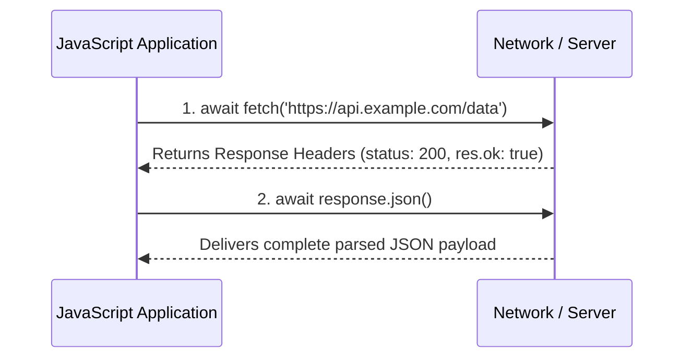

<div align="center">

# 🟪 <span style="color:#7C3AED">Level 06: Web APIs, Storage & Networking</span>

> *Browser integration and client-server communication: LocalStorage and SessionStorage persistence, JSON serialization, Browser Object Model (BOM), modern Fetch API, and foundational debugging pitfalls.*

[](06_web_apis_and_storage.md)
[](06_web_apis_and_storage.md)
[](06_web_apis_and_storage.md)

---

</div>

## 📌 Table of Contents
- [1. Web Storage: LocalStorage vs SessionStorage](#1-web-storage-localstorage-vs-sessionstorage)
- [2. JSON Serialization & Safe Retrieval Patterns](#2-json-serialization--safe-retrieval-patterns)
- [3. Browser Object Model (BOM)](#3-browser-object-model-bom)
- [4. Network Evolution: XMLHttpRequest vs Fetch API](#4-network-evolution-xmlhttprequest-vs-fetch-api)
- [5. The Fetch API Architecture](#5-the-fetch-api-architecture)
- [6. Common Developer Pitfalls & FAQs](#6-common-developer-pitfalls--faqs)
- [🎯 Practice Problems](#-practice-problems)
- [🧭 Summary Table](#-summary-table)

---

## 1. Web Storage: LocalStorage vs SessionStorage

Web Storage provides a client-side key-value database within the browser that persists data locally without burdening network requests:

| Parameter | `localStorage` | `sessionStorage` | Cookies (`document.cookie`) |
| :--- | :--- | :--- | :--- |
| **Capacity** | ~**5MB - 10MB** per origin | ~**5MB** per origin | ~**4KB** total |
| **Lifespan** | **Persistent**: Never expires until explicitly cleared | **Session**: Deleted automatically when tab/window closes | Configurable (`Expires` or `Max-Age`) |
| **Scope** | Shared across all tabs & windows of same origin | Isolated strictly to the **specific browser tab** | Shared across same domain & subdomains |
| **Network Overhead**| Never sent to server on HTTP requests | Never sent to server on HTTP requests | **Sent automatically** in HTTP headers with every request |
| **Access API** | Synchronous JavaScript API | Synchronous JavaScript API | String parsing API |

### Web Storage API Methods

Both `localStorage` and `sessionStorage` share the exact same method signatures:

```javascript
// 1. Setting items (Key and Value MUST be strings)
localStorage.setItem("theme", "dark");
localStorage.setItem("userId", "usr_9912");

// 2. Getting items
const currentTheme = localStorage.getItem("theme"); // "dark"
const nonExistent = localStorage.getItem("missingKey"); // null

// 3. Removing a single item
localStorage.removeItem("userId");

// 4. Getting key by index
const firstKey = localStorage.key(0); // Returns key name at index 0

// 5. Completely purging storage
// localStorage.clear();
```

---

## 2. JSON Serialization & Safe Retrieval Patterns

Web Storage stores **strings only**. Attempting to store an object or array directly invokes `.toString()`, converting your data into the useless string `"[object Object]"`:

```javascript
const userProfile = { name: "Nishant", score: 95 };

// MISTAKE:
localStorage.setItem("user", userProfile);
console.log(localStorage.getItem("user")); // "[object Object]" (Data corrupted!)
```

### Serialization via JSON Utilities

- **`JSON.stringify(data)`**: Serializes native JavaScript objects/arrays into standard JSON strings.
- **`JSON.parse(string)`**: Deserializes JSON strings back into native JavaScript objects/arrays.

```javascript
// CORRECT:
localStorage.setItem("user", JSON.stringify(userProfile));

// Reading back:
const savedUser = JSON.parse(localStorage.getItem("user"));
console.log(savedUser.name); // "Nishant"
```

### The Defensive Storage Retrieval Pattern

When reading an array (such as todo items or cart items) that might not yet exist in storage, `localStorage.getItem()` returns `null`. Parsing `null` yields `null`, which causes runtime crashes when calling `.forEach()` or `.map()`:

```javascript
// DANGEROUS:
const storedTodos = JSON.parse(localStorage.getItem("todos"));
// storedTodos.forEach(t => ...); // TypeError: Cannot read properties of null (reading 'forEach')

// PRODUCTION-SAFE DEFENSIVE PATTERN (Using Logical OR short-circuit):
const todos = JSON.parse(localStorage.getItem("todos")) || [];
todos.forEach(todo => console.log(todo)); // Safe! Iterates empty array if not found
```

> [!TIP]
> Always append `|| []` (for collections) or `|| {}` (for configuration dictionaries) when parsing data from `localStorage` to guarantee safe fallbacks.

---

## 3. Browser Object Model (BOM)

The **Browser Object Model (BOM)** represents all browser components outside the document content itself. Its root object is `window`:



### Core BOM Interfaces

```javascript
// 1. window.location: Inspect and manipulate current URL
console.log(location.href);     // Full URL: "https://mysite.com/store?cat=electronics"
console.log(location.pathname); // Path: "/store"
console.log(location.search);   // Query string: "?cat=electronics"

// Navigation redirects
// location.href = "https://example.com"; // Redirects to new page
// location.reload();                     // Reloads current page

// 2. window.navigator: Device and network status
console.log("Is device online?:", navigator.onLine); // true / false
console.log("Browser user agent:", navigator.userAgent);

// 3. window.history: Session navigation
// history.back();    // Equivalent to browser Back button
// history.forward(); // Equivalent to browser Forward button
// history.go(-2);    // Go back two pages
```

---

## 4. Network Evolution: XMLHttpRequest vs Fetch API

Before ES6, browsers relied on the cumbersome `XMLHttpRequest` object to perform background HTTP requests without reloading the page:

| Parameter | Legacy `XMLHttpRequest` (XHR) | Modern `Fetch API` |
| :--- | :--- | :--- |
| **API Architecture** | Event-driven callbacks (`onreadystatechange`) | **Promise-based** (`async`/`await` native) |
| **Code Verbosity** | High: manual state checking (`readyState === 4`) | Minimal: concise and declarative |
| **JSON Parsing** | Manual `JSON.parse(xhr.responseText)` | Built-in `.json()` streaming parser |
| **Standardization** | Historic legacy standard | Modern living standard across all browsers & Node |

```javascript
// Legacy XMLHttpRequest (For historical reference)
function fetchWithXHR(url) {
  const xhr = new XMLHttpRequest();
  xhr.open("GET", url);
  xhr.onreadystatechange = function() {
    if (xhr.readyState === 4 && xhr.status === 200) {
      const response = JSON.parse(xhr.responseText);
      console.log("XHR Data:", response);
    }
  };
  xhr.send();
}
```

---

## 5. The Fetch API Architecture

The **Fetch API** provides a powerful, Promise-based interface for making asynchronous network HTTP requests.

### The Two-Step Promise Resolution

Making a request with `fetch()` requires **two sequential `await` steps**:
1. **Step 1 (`fetch`)**: Resolves as soon as server HTTP headers arrive (providing status code and headers).
2. **Step 2 (`.json()`)**: Asynchronously reads and parses the incoming HTTP response body stream.



### Complete GET & POST Implementations

```javascript
// 1. HTTP GET Request: Fetching products
async function fetchProducts() {
  try {
    const response = await fetch("https://dummyjson.com/products?limit=5");

    // CRITICAL: Check HTTP status
    if (!response.ok) {
      throw new Error(`HTTP Error! Status: ${response.status} - ${response.statusText}`);
    }

    const data = await response.json();
    console.log("Products received:", data.products);
    return data.products;
  } catch (error) {
    console.error("Network or parsing failure:", error.message);
  }
}

// 2. HTTP POST Request: Creating a new user
async function createNewUser(userData) {
  try {
    const response = await fetch("https://dummyjson.com/users/add", {
      method: "POST",
      headers: {
        "Content-Type": "application/json" // Informs server the payload is JSON
      },
      body: JSON.stringify(userData) // Payload must be serialized to string!
    });

    if (!response.ok) {
      throw new Error(`Failed to create user. Status: ${response.status}`);
    }

    const createdRecord = await response.json();
    console.log("Server response:", createdRecord);
  } catch (err) {
    console.error("POST request failed:", err.message);
  }
}
```

> [!CAUTION]
> **The #1 Fetch API Gotcha**: `fetch()` **does NOT reject** on HTTP error status codes like `404 Not Found` or `500 Internal Server Error`! It only rejects when there is a physical network failure (such as losing internet connectivity or DNS failure). You **must** manually check `if (!response.ok)`!

---

## 6. Common Developer Pitfalls & FAQs

### 1. `null` vs `undefined`

- **`undefined`**: Means a variable has been declared but **has not yet been assigned a value**. It is JavaScript's default uninitialized state.
- **`null`**: An assignment value representing the **intentional absence of any object value**.

```javascript
let user;
console.log(user); // undefined (System default)

let activeSession = null; // Explicitly cleared by developer
console.log(activeSession); // null
```

### 2. `NaN` (Not a Number) Inconsistencies

`NaN` represents an invalid numerical operation (e.g., `"abc" * 5`). In JavaScript, `NaN` is unique because **it is not equal to itself**:

```javascript
console.log(typeof NaN);     // "number" (!)
console.log(NaN === NaN);    // false (!)

// Correct check:
console.log(Number.isNaN("abc" * 5)); // true
```

### 3. Primitive Copying vs Object Reference Mutation

- **Primitives** (numbers, strings, booleans) are copied **by value**: modifying the copy does not alter the original.
- **Objects & Arrays** are stored in heap memory and copied **by reference pointer**: mutating the copy alters the original object!

```javascript
// Primitive (Copy by Value):
let originalAge = 25;
let copiedAge = originalAge;
copiedAge = 30;
console.log(originalAge); // 25 (Unaltered)

// Reference Object (Copy by Reference):
const originalUser = { name: "Nishant", age: 25 };
const referenceUser = originalUser;
referenceUser.age = 30;
console.log(originalUser.age); // 30 (Altered unexpectedly!)
```

### 4. Shallow Copy vs Deep Copy

```javascript
const original = { a: 1, nested: { b: 2 } };

// Shallow Copy (Spread Operator):
const shallowCopy = { ...original };
shallowCopy.a = 99;         // original.a remains 1
shallowCopy.nested.b = 999; // MUTATES original.nested.b!

// Deep Copy (Modern native structuredClone):
const deepCopy = structuredClone(original);
deepCopy.nested.b = 555;    // original.nested.b remains 999
```

---

## 🎯 Practice Problems

1. **Persistent Theme Toggle**:
   Implement a dark mode toggle that reads the user's preferred theme from `localStorage` on page load. If no preference exists, default to `"light"`. When the toggle button is clicked, switch between `"dark"` and `"light"` and persist the updated preference back to `localStorage`.
   > *Hint: Use `localStorage.getItem("theme") || "light"` on initialization and update `document.body.classList` accordingly.*

2. **Defensive API Fetch Wrapper**:
   Write an `async` function `fetchWithTimeout(url, timeoutMs)` that races a `fetch(url)` call against a rejection timer using `Promise.race()`.
   > *Hint: Create a timer promise `new Promise((_, rej) => setTimeout(() => rej(new Error("Timeout")), timeoutMs))` and pass both into `Promise.race()`.*

---

## 🧭 Summary Table

| Concept | Purpose | Code Pattern |
| :--- | :--- | :--- |
| **`localStorage.setItem`** | Persist key-value string in client storage | `localStorage.setItem(k, JSON.stringify(v))` |
| **Defensive Retrieval** | Prevent null pointer exceptions | `JSON.parse(localStorage.getItem(k)) \|\| []` |
| **`window.location`** | Read URL properties and navigate | `window.location.search`, `location.href` |
| **`fetch()`** | Make modern Promise-based HTTP requests | `const res = await fetch(url)` |
| **`res.ok` Check** | Validate HTTP status codes (200-299) | `if (!res.ok) throw new Error(...)` |
| **`structuredClone()`** | Native deep copy of complex nested objects | `const copy = structuredClone(obj)` |

---

<div align="center">

⬅️ [Level 05: Asynchronous JavaScript & Promises](05_async_javascript_and_promises.md) | 🏠 [Roadmap](00_README.md) | ➡️ [Level 07: OOP, Prototypes & Classes](07_oop_prototypes_and_classes.md)

</div>
