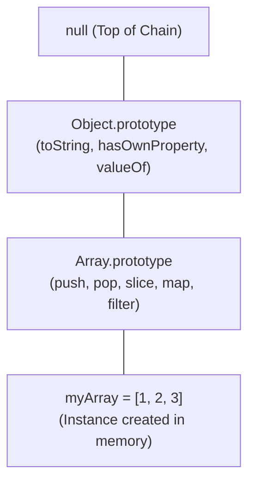
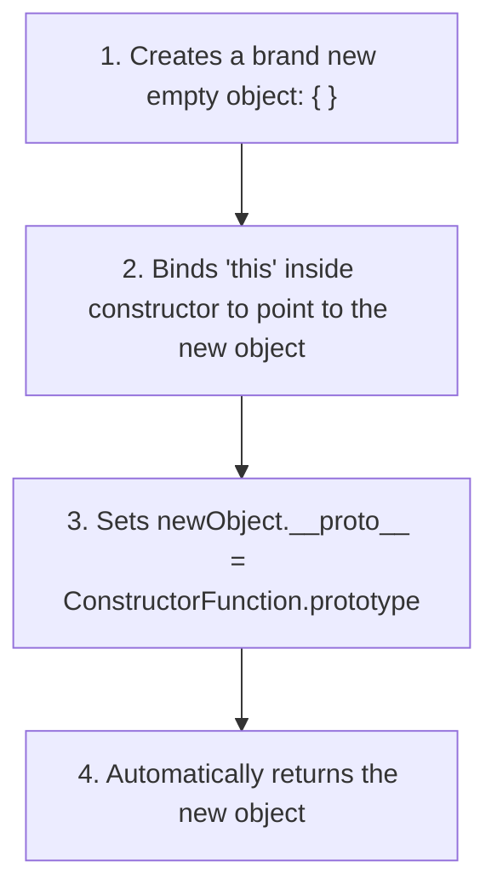
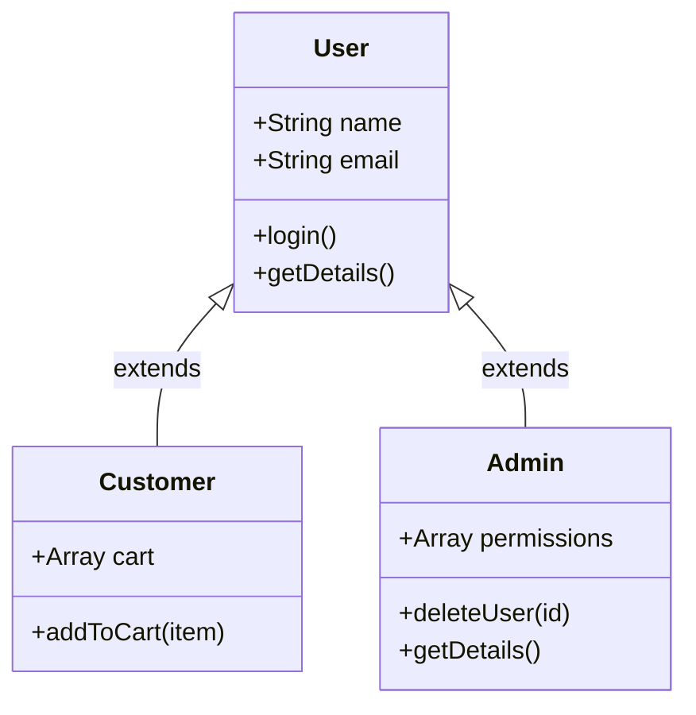

<div align="center">

# 🟦⬛ <span style="color:#1E3A8A">Level 07: OOP, Prototypes & Classes</span>

> *Object-oriented architecture in JavaScript: prototype delegation, the prototype chain, constructor functions, the `new` operator lifecycle, ES6 classes, inheritance with `super`, and explicit binding (`call`, `apply`, `bind`).*

[](07_oop_prototypes_and_classes.md)
[](07_oop_prototypes_and_classes.md)
[](07_oop_prototypes_and_classes.md)

---

</div>

## 📌 Table of Contents
- [1. Object-Oriented Principles in JavaScript](#1-object-oriented-principles-in-javascript)
- [2. Prototypes & The Prototype Chain](#2-prototypes--the-prototype-chain)
- [3. Constructor Functions & The `new` Lifecycle](#3-constructor-functions--the-new-lifecycle)
- [4. ES6 Classes: Syntactic Sugar Over Prototypes](#4-es6-classes-syntactic-sugar-over-prototypes)
- [5. Class Inheritance with `extends` & `super`](#5-class-inheritance-with-extends--super)
- [6. Explicit Function Binding: `call`, `apply` & `bind`](#6-explicit-function-binding-call-apply--bind)
- [🎯 Practice Problems](#-practice-problems)
- [🧭 Summary Table](#-summary-table)

---

## 1. Object-Oriented Principles in JavaScript

**Object-Oriented Programming (OOP)** is a design paradigm organized around entities ("objects") containing state (properties) and behavior (methods), rather than unstructured functions.

### Core OOP Principles

| Principle | Meaning in JavaScript | Concrete Implementation |
| :--- | :--- | :--- |
| **Encapsulation** | Bundling data and methods together while restricting direct outside access | ES6 Private Fields (`#field`) and Closures |
| **Abstraction** | Hiding internal execution complexity and exposing simple public APIs | Public class methods (`cart.checkout()`) |
| **Inheritance** | Child entities inherit properties and methods from parent blueprints | Prototype Chain, `class Child extends Parent` |
| **Polymorphism** | Ability for different classes to implement identical methods with unique behaviors | Method overriding via `super.method()` |

---

## 2. Prototypes & The Prototype Chain

JavaScript is fundamentally a **prototype-based language**. Unlike class-based languages (Java, C++) where classes exist as distinct runtime constructs, JavaScript objects inherit directly from other objects via prototype links.

### `__proto__` vs `prototype`

| Property | Where It Exists | Purpose |
| :--- | :--- | :--- |
| **`prototype`** | On **Constructor Functions** and **Classes** | The blueprint object that will become the prototype of all instances created by `new` |
| **`__proto__`** | On **every instantiated Object** | The actual live pointer referencing its parent prototype in memory |



### Prototype Delegation & Property Shadowing

When accessing `myArray.push(4)`, the JavaScript engine executes the **Prototype Lookup**:
1. Checks if `push` exists as an "own property" directly on `myArray`. (No)
2. Follows `myArray.__proto__` to `Array.prototype`. Finds `push`! Executes it.
3. If not found, it follows `Array.prototype.__proto__` to `Object.prototype`.
4. If still not found, `Object.prototype.__proto__` points to `null` -> returns `undefined`.

```javascript
const user = {
  role: "customer",
  greet() {
    return `Hello, role: ${this.role}`;
  }
};

// Create admin inheriting prototype from user
const admin = Object.create(user);
admin.role = "admin"; // Property Shadowing: shadows parent's 'role' on admin instance

console.log(admin.role);        // "admin" (Found on instance directly)
console.log(admin.greet());       // "Hello, role: admin" (Method delegated to prototype!)
console.log(admin.hasOwnProperty("role"));  // true
console.log(admin.hasOwnProperty("greet")); // false (Belongs to prototype user)
```

---

## 3. Constructor Functions & The `new` Lifecycle

Before ES6 classes, constructor functions paired with the `new` keyword served as object factories:

### The 4 Steps Executed by the `new` Operator



```javascript
// 1. Constructor Function (Capitalized by convention)
function Product(title, price) {
  // 'this' points to the newly created instance
  this.title = title;
  this.price = price;
}

// 2. Memory Optimization: Attach methods to .prototype
// Doing this shares ONE function in memory across 10,000 product instances!
Product.prototype.getDiscountedPrice = function(percent) {
  return this.price - (this.price * percent / 100);
};

// 3. Instantiation using 'new'
const phone = new Product("SmartPhone", 49999);
const laptop = new Product("Laptop", 89999);

console.log(phone.getDiscountedPrice(10)); // 44999.1
console.log(phone.__proto__ === Product.prototype); // true
```

> [!CAUTION]
> If you invoke a constructor function without `new` (e.g., `const p = Product("Phone", 1000)`), `this` will point to the global `window` object in non-strict mode, polluting the global namespace and setting `p` to `undefined`.

---

## 4. ES6 Classes: Syntactic Sugar Over Prototypes

Introduced in ES6 (2015), the `class` keyword provides clean, modern syntactic sugar over JavaScript's existing prototype delegation architecture:

```javascript
class Vehicle {
  // Private field (starts with #) - cannot be accessed outside the class
  #engineNumber;

  constructor(make, model, engineNumber) {
    this.make = make;
    this.model = model;
    this.#engineNumber = engineNumber;
    this.speed = 0;
  }

  // Public Instance Method (automatically mounted on Vehicle.prototype)
  accelerate(amount) {
    this.speed += amount;
    return `${this.make} ${this.model} accelerating to ${this.speed} km/h`;
  }

  // Getter
  get engineInfo() {
    return `Engine ID: ${this.#engineNumber}`;
  }

  // Static Method (mounted on the Vehicle class itself, NOT instances)
  static compareSpeed(v1, v2) {
    return v1.speed > v2.speed ? `${v1.make} is faster` : `${v2.make} is faster`;
  }
}

const myCar = new Vehicle("Tata", "Harrier", "ENG_8831");
console.log(myCar.accelerate(60));  // "Tata Harrier accelerating to 60 km/h"
console.log(myCar.engineInfo);      // "Engine ID: ENG_8831"
// console.log(myCar.#engineNumber); // SyntaxError: Private field must be declared in an enclosing class
```

---

## 5. Class Inheritance with `extends` & `super`

The `extends` keyword establishes a prototype inheritance chain between classes, while `super()` invokes the parent constructor:



### Implementation

```javascript
// Base Parent Class
class User {
  constructor(name, email) {
    this.name = name;
    this.email = email;
    this.isLoggedIn = false;
  }

  login() {
    this.isLoggedIn = true;
    console.log(`${this.name} has logged in.`);
  }

  getDetails() {
    return `User: ${this.name} (${this.email})`;
  }
}

// Subclass: Admin inherits from User
class Admin extends User {
  constructor(name, email, permissions = ["READ", "WRITE", "DELETE"]) {
    // CRITICAL: Must call super() before accessing 'this'!
    super(name, email); // Invokes User constructor
    this.permissions = permissions;
  }

  // Method Overriding & Polymorphism
  getDetails() {
    // Invoke parent method using super.method()
    const baseDetails = super.getDetails();
    return `${baseDetails} | Role: ADMIN [${this.permissions.join(", ")}]`;
  }

  deleteDatabase() {
    console.log(`Admin ${this.name} triggered database purge.`);
  }
}

const adminUser = new Admin("Nishant", "admin@company.com");
adminUser.login(); // Inherited from User
console.log(adminUser.getDetails()); // Overridden implementation
```

> [!WARNING]
> In derived class constructors, you **must call `super()` before referencing `this`**. Failing to call `super()` results in a `ReferenceError: Must call super constructor in derived class before accessing 'this'`.

---

## 6. Explicit Function Binding: `call`, `apply` & `bind`

When a function needs to be executed with a specific `this` context, JavaScript provides three explicit binding methods on `Function.prototype`:

| Method | Execution Timing | Argument Format | Return Value |
| :--- | :--- | :--- | :--- |
| **`call()`** | **Immediately** | Comma-separated: `fn.call(thisArg, arg1, arg2)` | Function's return value |
| **`apply()`**| **Immediately** | Array of arguments: `fn.apply(thisArg, [arg1, arg2])` | Function's return value |
| **`bind()`** | **Deferred (Later)** | Comma-separated: `fn.bind(thisArg, arg1, arg2)` | **New permanently bound function** |

### Code Comparison

```javascript
const userA = { name: "Nishant", role: "Instructor" };
const userB = { name: "Aman", role: "Developer" };

function printProfile(greeting, punctuation) {
  console.log(`${greeting}! I am ${this.name}, working as a ${this.role}${punctuation}`);
}

// 1. call(): Invokes immediately with comma-separated arguments
printProfile.call(userA, "Namaste", ".");
// "Namaste! I am Nishant, working as a Instructor."

// 2. apply(): Invokes immediately with an array of arguments
printProfile.apply(userB, ["Hello", "!"]);
// "Hello! I am Aman, working as a Developer!"

// 3. bind(): Returns a new bound function for event handlers or delayed callbacks
const boundToUserA = printProfile.bind(userA, "Welcome");
boundToUserA("!!!"); // Invoked later; permanently bound to userA
```

---

## 🎯 Practice Problems

1. **Simulate `new` Operator**:
   Write a custom helper function `myNew(ConstructorFn, ...args)` that replicates the 4 internal steps of the `new` operator without using `new`.
   > *Hint: Create an object with `Object.create(ConstructorFn.prototype)`, invoke `ConstructorFn.apply(newObj, args)`, and return the object.*

2. **Method Borrowing with `apply()`**:
   Using `Math.max.apply()`, find the maximum number inside an arbitrary array `[45, 99, 12, 88, 3]`.
   > *Hint: `Math.max` expects comma-separated numbers; `apply(null, arr)` unpacks the array arguments.*

---

## 🧭 Summary Table

| Concept | Purpose | Syntax Pattern |
| :--- | :--- | :--- |
| **Prototype Chain** | Fallback inheritance mechanism | `instance.__proto__ === Class.prototype` |
| **`new` Keyword** | Instantiates object, binds `this`, links prototype | `const inst = new ClassName()` |
| **ES6 `class`** | Clean blueprint declaration syntax | `class User { constructor() {} }` |
| **`extends` / `super`** | Subclassing and parent method invocation | `class Sub extends Base { constructor() { super(); } }` |
| **Private Fields** | True engine-enforced data privacy | `#privateVar = 10;` |
| **`call` / `apply`** | Immediate explicit context binding | `fn.call(ctx, 1, 2)` / `fn.apply(ctx, [1, 2])` |
| **`bind`** | Returns new function permanently bound to context | `const bound = fn.bind(ctx)` |

---

<div align="center">

⬅️ [Level 06: Web APIs, Storage & Networking](06_web_apis_and_storage.md) | 🏠 [Roadmap](00_README.md) | ➡️ [Level 08: Full-Stack Projects & Architecture](08_fullstack_projects_and_architecture.md)

</div>
