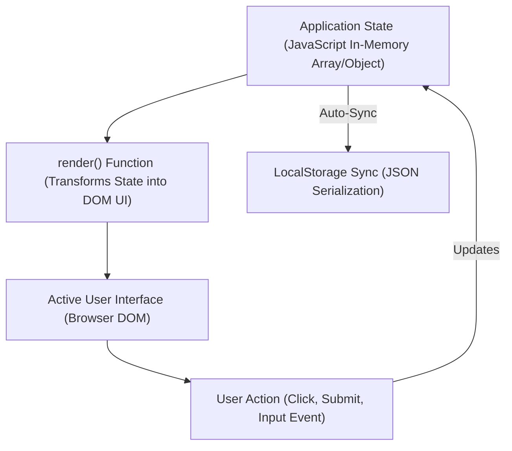
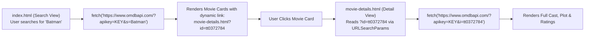
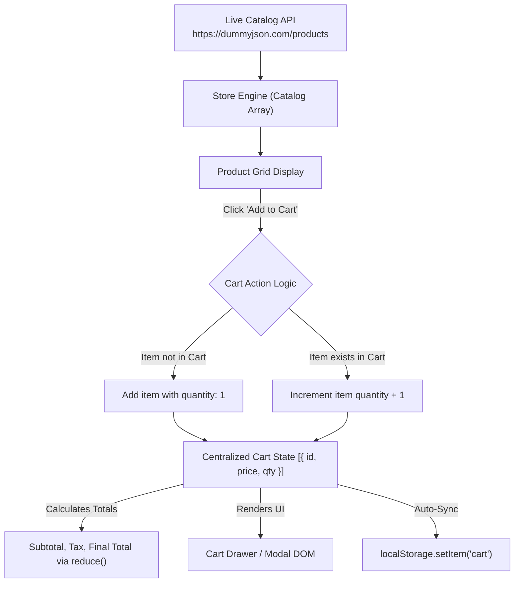

<div align="center">

# ⬛ <span style="color:#111827">Level 08: Production Projects & Application Architecture</span>

> *End-to-end frontend system design in Vanilla JavaScript: state-driven DOM rendering, Event Delegation architectures, multi-page URL routing (`URLSearchParams`), external REST API integrations, and complete e-commerce cart state engines.*

[](08_fullstack_projects_and_architecture.md)
[](08_fullstack_projects_and_architecture.md)
[](08_fullstack_projects_and_architecture.md)

---

</div>

## 📌 Table of Contents
- [1. State-Driven Architecture in Vanilla JavaScript](#1-state-driven-architecture-in-vanilla-javascript)
- [2. Project 1: Dynamic Todo Engine with Local Persistence](#2-project-1-dynamic-todo-engine-with-local-persistence)
- [3. Project 2: Movie Hub with Asynchronous REST API & URL Routing](#3-project-2-movie-hub-with-asynchronous-rest-api--url-routing)
- [4. Project 3: Full-Featured E-Commerce Store & Cart Management Engine](#4-project-3-full-featured-e-commerce-store--cart-management-engine)
- [5. Production Best Practices & Engineering Guidelines](#5-production-best-practices--engineering-guidelines)
- [🎯 Practice Problems](#-practice-problems)
- [🧭 Summary Table](#-summary-table)
- [🔮 Coming Next](#-coming-next)

---

## 1. State-Driven Architecture in Vanilla JavaScript

In production web development, applications should follow a **single source of truth (State-Driven)** pattern:



### Core Architectural Rules

1. **Never treat the DOM as your database**: Do not read state values out of DOM elements (`div.textContent`) to make business decisions.
2. **State precedes UI**: First mutate the in-memory JavaScript data array or object, then trigger a re-render of the DOM.
3. **Persist the State**: Write the updated state directly to `localStorage` following every mutation.

---

## 2. Project 1: Dynamic Todo Engine with Local Persistence

*Lectures 42 & 43: Complete Todo management application featuring item creation, state toggling, filtering, deletion, and persistent storage.*

```javascript
// ==========================================
// 1. STATE INITIALIZATION (Single Source of Truth)
// ==========================================
let todos = JSON.parse(localStorage.getItem("app_todos")) || [];
let currentFilter = "all"; // "all" | "active" | "completed"

// DOM Elements
const todoForm = document.querySelector("#todo-form");
const todoInput = document.querySelector("#todo-input");
const todoList = document.querySelector("#todo-list");
const filterButtons = document.querySelectorAll(".filter-btn");

// ==========================================
// 2. RENDERING FUNCTION
// ==========================================
function renderTodos() {
  todoList.innerHTML = "";

  // Apply current filter
  const filtered = todos.filter(todo => {
    if (currentFilter === "active") return !todo.completed;
    if (currentFilter === "completed") return todo.completed;
    return true; // "all"
  });

  if (filtered.length === 0) {
    todoList.innerHTML = `<li class="empty-state">No todos to show.</li>`;
    return;
  }

  filtered.forEach(todo => {
    const li = document.createElement("li");
    li.className = `todo-item ${todo.completed ? "completed" : ""}`;
    li.dataset.id = todo.id;

    li.innerHTML = `
      <input type="checkbox" class="toggle-checkbox" ${todo.completed ? "checked" : ""}>
      <span class="todo-text">${todo.text}</span>
      <button class="btn-delete" title="Delete Todo">&times;</button>
    `;
    todoList.appendChild(li);
  });
}

// ==========================================
// 3. STATE MUTATION & LOCAL PERSISTENCE
// ==========================================
function saveAndRender() {
  localStorage.setItem("app_todos", JSON.stringify(todos));
  renderTodos();
}

function addTodo(text) {
  const newTodo = {
    id: Date.now().toString(), // Unique timestamp ID
    text: text.trim(),
    completed: false,
    createdAt: new Date().toISOString()
  };
  todos.push(newTodo);
  saveAndRender();
}

function toggleTodo(id) {
  todos = todos.map(todo => {
    if (todo.id === id) {
      return { ...todo, completed: !todo.completed };
    }
    return todo;
  });
  saveAndRender();
}

function deleteTodo(id) {
  todos = todos.filter(todo => todo.id !== id);
  saveAndRender();
}

// ==========================================
// 4. EVENT LISTENERS (Form & Event Delegation)
// ==========================================
// Form submission handler
todoForm.addEventListener("submit", (e) => {
  e.preventDefault();
  const text = todoInput.value.trim();
  if (!text) return;
  addTodo(text);
  todoInput.value = "";
});

// Event Delegation on list container
todoList.addEventListener("click", (e) => {
  const parentLi = e.target.closest(".todo-item");
  if (!parentLi) return;
  const todoId = parentLi.dataset.id;

  if (e.target.classList.contains("toggle-checkbox")) {
    toggleTodo(todoId);
  } else if (e.target.classList.contains("btn-delete")) {
    deleteTodo(todoId);
  }
});

// Initial boot
renderTodos();
```

---

## 3. Project 2: Movie Hub with Asynchronous REST API & URL Routing

*Lectures 50 & 51: Multi-page web application integrating external REST endpoints, query handling, and parameter extraction with `URLSearchParams`.*

### Multi-Page URL Architecture



### Search Page Implementation (`index.js`)

```javascript
const API_KEY = "your_omdb_api_key";
const searchForm = document.querySelector("#search-form");
const searchInput = document.querySelector("#search-input");
const movieGrid = document.querySelector("#movie-grid");
const statusMsg = document.querySelector("#status-message");

searchForm.addEventListener("submit", async (e) => {
  e.preventDefault();
  const query = searchInput.value.trim();
  if (!query) return;

  statusMsg.textContent = "Loading movies...";
  movieGrid.innerHTML = "";

  try {
    const response = await fetch(`https://www.omdbapi.com/?apikey=${API_KEY}&s=${encodeURIComponent(query)}`);
    const data = await response.json();

    if (data.Response === "True") {
      statusMsg.textContent = "";
      renderMovies(data.Search);
    } else {
      statusMsg.textContent = data.Error || "No movies found.";
    }
  } catch (err) {
    statusMsg.textContent = "Failed to connect to movie server.";
    console.error(err);
  }
});

function renderMovies(movies) {
  movieGrid.innerHTML = movies.map(movie => `
    <div class="movie-card">
      
      <h3>${movie.Title}</h3>
      <p>Year: ${movie.Year}</p>
      <a href="movie-details.html?id=${movie.imdbID}" class="btn-details">View Details</a>
    </div>
  `).join("");
}
```

### Detail Page Parameter Extraction (`movie-details.js`)

```javascript
// Extract URL query parameters on page load: movie-details.html?id=tt10872600
const params = new URLSearchParams(window.location.search);
const movieId = params.get("id"); // "tt10872600"
const container = document.querySelector("#details-container");

async function loadMovieDetails() {
  if (!movieId) {
    container.innerHTML = "<p>Invalid movie ID specified.</p>";
    return;
  }

  container.innerHTML = "<p>Loading movie profile...</p>";

  try {
    const res = await fetch(`https://www.omdbapi.com/?apikey=${API_KEY}&i=${movieId}&plot=full`);
    const movie = await res.json();

    if (movie.Response === "True") {
      container.innerHTML = `
        <div class="movie-detail-view">
          
          <div class="detail-info">
            <h2>${movie.Title} (${movie.Year})</h2>
            <p><strong>Genre:</strong> ${movie.Genre}</p>
            <p><strong>Director:</strong> ${movie.Director}</p>
            <p><strong>Actors:</strong> ${movie.Actors}</p>
            <p><strong>IMDb Rating:</strong> ⭐ ${movie.imdbRating} / 10</p>
            <p class="plot"><strong>Plot:</strong> ${movie.Plot}</p>
            <a href="index.html" class="btn-back">⬅️ Back to Search</a>
          </div>
        </div>
      `;
    }
  } catch (err) {
    container.innerHTML = "<p>Failed to load movie details.</p>";
  }
}

loadMovieDetails();
```

---

## 4. Project 3: Full-Featured E-Commerce Store & Cart Management Engine

*Lectures 55, 56 & 57: Complete store architecture fetching live catalog items from `https://dummyjson.com/products`, dynamic product card rendering, and synchronized cart state management.*



### Full E-Commerce Script Implementation

```javascript
// ==========================================
// 1. STATE & STORAGE MANAGEMENT
// ==========================================
let products = [];
let cart = JSON.parse(localStorage.getItem("ecommerce_cart")) || [];

// DOM Containers
const catalogGrid = document.querySelector("#catalog-grid");
const cartDrawer = document.querySelector("#cart-drawer");
const cartItemsContainer = document.querySelector("#cart-items");
const cartTotalElement = document.querySelector("#cart-total-price");
const cartBadge = document.querySelector("#cart-badge-count");

// ==========================================
// 2. FETCH & RENDER CATALOG
// ==========================================
async function initializeStore() {
  try {
    const response = await fetch("https://dummyjson.com/products?limit=12");
    const data = await response.json();
    products = data.products;
    renderCatalog();
    renderCart();
  } catch (error) {
    catalogGrid.innerHTML = `<p class="error">Failed to load product catalog.</p>`;
    console.error(error);
  }
}

function renderCatalog() {
  catalogGrid.innerHTML = products.map(prod => `
    <div class="product-card" data-id="${prod.id}">
      
      <div class="product-info">
        <h3 class="product-title">${prod.title}</h3>
        <p class="product-category">${prod.category.toUpperCase()}</p>
        <div class="price-row">
          <span class="price">$${prod.price.toFixed(2)}</span>
          <button class="btn-add-cart">Add to Cart</button>
        </div>
      </div>
    </div>
  `).join("");
}

// ==========================================
// 3. CART MUTATION LOGIC
// ==========================================
function saveCartAndSync() {
  localStorage.setItem("ecommerce_cart", JSON.stringify(cart));
  renderCart();
}

function addToCart(productId) {
  const product = products.find(p => p.id === productId);
  if (!product) return;

  const existingItem = cart.find(item => item.id === productId);

  if (existingItem) {
    existingItem.quantity += 1;
  } else {
    cart.push({
      id: product.id,
      title: product.title,
      price: product.price,
      thumbnail: product.thumbnail,
      quantity: 1
    });
  }
  saveCartAndSync();
}

function updateQuantity(productId, delta) {
  const item = cart.find(i => i.id === productId);
  if (!item) return;

  item.quantity += delta;

  // Remove if quantity drops to 0
  if (item.quantity <= 0) {
    removeFromCart(productId);
    return;
  }
  saveCartAndSync();
}

function removeFromCart(productId) {
  cart = cart.filter(item => item.id !== productId);
  saveCartAndSync();
}

// ==========================================
// 4. RENDER CART & TOTALS
// ==========================================
function renderCart() {
  // Update badge count
  const totalItemCount = cart.reduce((sum, item) => sum + item.quantity, 0);
  cartBadge.textContent = totalItemCount;

  if (cart.length === 0) {
    cartItemsContainer.innerHTML = `<p class="empty-cart">Your cart is empty.</p>`;
    cartTotalElement.textContent = "$0.00";
    return;
  }

  // Render list of cart rows
  cartItemsContainer.innerHTML = cart.map(item => `
    <div class="cart-item" data-id="${item.id}">
      
      <div class="item-details">
        <h4>${item.title}</h4>
        <p>$${item.price.toFixed(2)} × ${item.quantity} = $${(item.price * item.quantity).toFixed(2)}</p>
        <div class="qty-controls">
          <button class="btn-qty-minus">-</button>
          <span class="qty-number">${item.quantity}</span>
          <button class="btn-qty-plus">+</button>
          <button class="btn-item-remove">Remove</button>
        </div>
      </div>
    </div>
  `).join("");

  // Calculate grand total using reduce
  const grandTotal = cart.reduce((total, item) => total + (item.price * item.quantity), 0);
  cartTotalElement.textContent = `$${grandTotal.toFixed(2)}`;
}

// ==========================================
// 5. EVENT DELEGATION
// ==========================================
// Catalog click delegation (Add to Cart)
catalogGrid.addEventListener("click", (e) => {
  if (e.target.classList.contains("btn-add-cart")) {
    const card = e.target.closest(".product-card");
    const productId = Number(card.dataset.id);
    addToCart(productId);
  }
});

// Cart drawer click delegation (+, -, Remove)
cartItemsContainer.addEventListener("click", (e) => {
  const row = e.target.closest(".cart-item");
  if (!row) return;
  const productId = Number(row.dataset.id);

  if (e.target.classList.contains("btn-qty-plus")) {
    updateQuantity(productId, 1);
  } else if (e.target.classList.contains("btn-qty-minus")) {
    updateQuantity(productId, -1);
  } else if (e.target.classList.contains("btn-item-remove")) {
    removeFromCart(productId);
  }
});

// Boot the store
initializeStore();
```

---

## 5. Production Best Practices & Engineering Guidelines

1. **Defensive API Extraction**: Never assume nested fields always exist. Use **Optional Chaining (`?.`)** and **Nullish Coalescing (`??`)**:
   ```javascript
   const rating = product?.rating?.rate ?? "No rating";
   ```
2. **Search Debouncing**: Prevent firing API calls on every keystroke when user is typing:
   ```javascript
   function debounce(fn, delayMs = 300) {
     let timer;
     return function(...args) {
       clearTimeout(timer);
       timer = setTimeout(() => fn.apply(this, args), delayMs);
     };
   }
   ```
3. **Immutability in State Operations**:
   - Add item: `[...cart, newItem]`
   - Remove item: `cart.filter(item => item.id !== targetId)`
   - Update item: `cart.map(item => item.id === targetId ? { ...item, qty: item.qty + 1 } : item)`

---

## 🎯 Practice Problems

1. **E-Commerce Coupon System**:
   Extend the e-commerce cart engine with an `applyCoupon(code)` method. If `code === "DISCOUNT20"`, subtract 20% from the grand total before rendering. Ensure the discount persists in `localStorage` alongside cart items.
   > *Hint: Store `appliedDiscount = 0.20` in application state and incorporate it into the total calculation function.*

2. **Cart Clear Confirmation**:
   Add a "Clear Cart" button with an interactive modal confirmation. Only if confirmed should `cart = []`, `localStorage.removeItem("ecommerce_cart")`, and `renderCart()` be invoked.
   > *Hint: Use a custom hidden modal element and toggle its display with `.classList.toggle("open")`.*

---

## 🧭 Summary Table

| Architectural Concept | Purpose | Implementation Technique |
| :--- | :--- | :--- |
| **State-Driven UI** | Ensure UI matches data without drift | Single State array + dedicated `render()` function |
| **Local Persistence** | Retain data across page refreshes | `localStorage.setItem(k, JSON.stringify(v))` |
| **Event Delegation** | Manage actions on dynamically rendered nodes | Single listener on parent + `e.target.closest()` |
| **`URLSearchParams`** | Multi-page routing and parameter passing | `const id = new URLSearchParams(location.search).get('id')` |
| **Cart Reducer** | Calculate live pricing totals | `cart.reduce((sum, item) => sum + item.price * item.quantity, 0)` |
| **Debounce** | Throttle high-frequency user events | Clear and reset `setTimeout` wrapper |

---

<div align="center">

<p style="color: #6B7280; font-style: italic;">
🔮 <b>Coming Next: Advanced Frontend Engineering & Frameworks</b><br>
Modern Frontend Frameworks (React, Next.js), Component State Management (Redux Toolkit, Zustand), TypeScript Static Typing, Server-Side Rendering (SSR), and Full-Stack Node.js/Express Backend Development.
</p>

---

⬅️ [Level 07: OOP, Prototypes & Classes](07_oop_prototypes_and_classes.md) | 🏠 [Roadmap](00_README.md)

</div>
